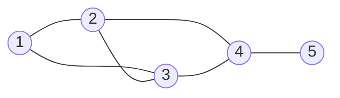

---
aliases:
  - MIT 18.06SC Session 1.12 - Matrix Spaces, Rank 1, Small World Graphs
  - 18.06 第十二讲正式笔记
tags:
  - course-note
---

<!-- bilingual-en:start -->
# 1.12 Matrix Spaces, Rank 1, Small World Graphs
<!-- bilingual-en:end -->
*矩阵空间、秩一矩阵与小世界图*

<!-- review-entry:start -->

<!-- bilingual-en:start -->
## Recall
<!-- bilingual-en:end -->
*主动回忆*

<!-- bilingual-en:start -->
Start from the topic cues, then open a question if needed. Try before opening its answer. The two tests below are new practice, separate from the official assignment.
<!-- bilingual-en:end -->

先按主题回忆，需要时再展开具体问题；尝试后再看答案。后面两道小测是新构造的练习，与官方作业分开。

> [!info] Topics · 主题
> <!-- bilingual-en:start -->
> Matrices as vectors; operations on subspaces; the roles of rows and columns.
> <!-- bilingual-en:end -->
>
> 矩阵作为向量；子空间的运算；行与列各自的作用。
>
> > [!question]- Prompt 1 · 具体问题
> > <!-- bilingual-en:start -->
> > Why does the space of all $3\times3$ matrices have dimension $9$, even though a $3\times3$ matrix has rank at most $3$?
> > <!-- bilingual-en:end -->
> >
> > 为什么全部 $3\times3$ 矩阵组成的空间是九维的，而一个 $3\times3$ 矩阵的秩最多是 $3$？
> >
> > > [!success]- Answer 1 · 答案
> > > <!-- bilingual-en:start -->
> > > The space has nine independently variable entries, controlled by the nine matrices $E_{ij}$. The rank of one matrix counts independent columns within that matrix. See [[#1. The whole matrix is one vector|matrix-space dimension]].
> > > <!-- bilingual-en:end -->
> > >
> > > 矩阵空间有九个可独立选择的元素，由九个 $E_{ij}$ 控制；单个矩阵的秩数的是它自身的独立列。见[[#1. The whole matrix is one vector|矩阵空间的维数]]。
>
> > [!question]- Prompt 2 · 具体问题
> > <!-- bilingual-en:start -->
> > Let $S$ be the symmetric $3\times3$ matrices and $U$ the upper triangular ones. What does $S+U$ allow you to construct that $S\cup U$ does not automatically include?
> > <!-- bilingual-en:end -->
> >
> > 设 $S$ 是全部对称 $3\times3$ 矩阵，$U$ 是全部上三角 $3\times3$ 矩阵。$S+U$ 允许构造什么元素，而 $S\cup U$ 不一定包含这些元素？
> >
> > > [!success]- Answer 2 · 答案
> > > <!-- bilingual-en:start -->
> > > It allows one member of $S$ plus one member of $U$. Their sum may belong to neither original set. The union only collects elements already in one set or the other. See [[#2. Intersection, union, and sum|the matrix counterexample]].
> > > <!-- bilingual-en:end -->
> > >
> > > 它允许从 $S,U$ 各取一个元素相加，结果可能不属于原来任何一边；并集只收集本来就在某一边的元素。见[[#2. Intersection, union, and sum|矩阵反例]]。
>
> > [!question]- Prompt 3 · 具体问题
> > <!-- bilingual-en:start -->
> > If $X=[x_1\ x_2\ x_3]$, what does the single equation $AX=0$ require of each column?
> > <!-- bilingual-en:end -->
> >
> > 若 $X=[x_1\ x_2\ x_3]$，一个矩阵方程 $AX=0$ 对每一列分别提出什么要求？
> >
> > > [!success]- Answer 3 · 答案
> > > <!-- bilingual-en:start -->
> > > It requires $Ax_j=0$ for each $j$, so the three columns can be chosen separately from $N(A)$. See [[#6. Exercise 11.2: the map X to AX|the kernel calculation]].
> > > <!-- bilingual-en:end -->
> > >
> > > 每列都要满足 $Ax_j=0$，所以三列可以分别从 $N(A)$ 中选择。见[[#6. Exercise 11.2: the map X to AX|核的计算]]。

<!-- bilingual-en:start -->
## Quick self-test
<!-- bilingual-en:end -->
*快速自测，约 5–8 分钟*

> [!example] Test 1 · 小测一
> $$
> B=\begin{pmatrix}2&6&0\\-1&-3&0\end{pmatrix}.
> $$
> <!-- bilingual-en:start -->
> Write $B=uv^T$ with $u,v$ column vectors, and state their sizes.
> <!-- bilingual-en:end -->
>
> 将 $B$ 写成 $uv^T$，其中 $u,v$ 都是列向量，并注明两者的尺寸。
>
> > [!question]- Hint · 提示
> > <!-- bilingual-en:start -->
> > Pick a nonzero column of $B$ and compare the other columns with it.
> > <!-- bilingual-en:end -->
> >
> > 选取 $B$ 的一条非零列，比较其余列和它的关系。
>
> > [!success]- Solution and checks · 解答与核对
> > $$
> > u=\begin{pmatrix}2\\-1\end{pmatrix},\qquad
> > v=\begin{pmatrix}1\\3\\0\end{pmatrix}.
> > $$
> > <!-- bilingual-en:start -->
> > The sizes are $2\times1$ and $3\times1$, so $uv^T$ is $2\times3$. Multiplication reproduces all three columns. Nonzero reciprocal rescalings of the two factors are equally valid. See [[#4. Rank-one matrices and their sums|column times row]].
> > <!-- bilingual-en:end -->
> >
> > 尺寸分别为 $2\times1$、$3\times1$，因此 $uv^T$ 为 $2\times3$，回乘能得到全部三列。两个因子作互相抵消的非零缩放也正确。见[[#4. Rank-one matrices and their sums|列乘行]]。

> [!example] Test 2 · 小测二
> $$
> A=\begin{pmatrix}1&-1\\0&0\end{pmatrix},\qquad X\in M_{2,2}(\mathbb R).
> $$
> <!-- bilingual-en:start -->
> Describe all matrices $X$ satisfying $AX=0$ and give the dimension of that space of matrices.
> <!-- bilingual-en:end -->
>
> 写出满足 $AX=0$ 的全部矩阵 $X$，并求这个矩阵空间的维数。
>
> > [!question]- Hint · 提示
> > <!-- bilingual-en:start -->
> > Write four entries for $X$ and expand the product $AX$.
> > <!-- bilingual-en:end -->
> >
> > 给 $X$ 的四个元素分别设未知数，展开 $AX$。
>
> > [!success]- Solution and checks · 解答与核对
> > $$
> > X=\begin{pmatrix}a&b\\a&b\end{pmatrix}
> > =a\begin{pmatrix}1&0\\1&0\end{pmatrix}
> > +b\begin{pmatrix}0&1\\0&1\end{pmatrix},\qquad a,b\in\mathbb R.
> > $$
> > <!-- bilingual-en:start -->
> > The dimension is $2$. Multiplication verifies that every displayed matrix is sent to zero, and $AX=0$ forces the two rows to agree, so none are omitted. The two coefficient matrices are independent. Counting only one column would miss one free parameter. See [[#6. Exercise 11.2: the map X to AX|counting independently varying columns]].
> > <!-- bilingual-en:end -->
> >
> > 维数为 $2$。回乘验证这些矩阵全部满足条件；$AX=0$ 又迫使两行相同，所以没有遗漏。两个系数矩阵无关。只数一列会漏掉另一个自由参数。见[[#6. Exercise 11.2: the map X to AX|分列计算自由度]]。

<!-- review-entry:end -->

<!-- bilingual-en:start -->
## 1. The whole matrix is one vector
<!-- bilingual-en:end -->
*一个矩阵作为一个元素，九个自由位置给出九维空间*

<!-- bilingual-en:start -->
The ideas of addition, scalar multiplication, basis, and dimension apply even when a “vector” is a matrix or a function. In the [[矩阵空间|matrix space]] $M=M_{3,3}(\mathbb R)$, each element is a whole $3\times3$ matrix. Addition and scalar multiplication act entry by entry; matrix multiplication is a separate operation.
<!-- bilingual-en:end -->

加法、数乘、基和维数也适用于矩阵或函数这样的“向量”。在[[矩阵空间]] $M=M_{3,3}(\mathbb R)$ 中，每个元素是一个完整的 $3\times3$ 矩阵。加法与数乘逐项进行，矩阵乘法是另外一种运算。

<!-- bilingual-en:start -->
Let $E_{ij}$ have $1$ at position $(i,j)$ and zeros elsewhere. Every $X\in M$ has a unique expansion $X=\sum_{i,j}x_{ij}E_{ij}$. There are nine freely chosen coefficients, so $\dim M=9$. This is different from the rank of one $X$, which is at most $3$.
<!-- bilingual-en:end -->

令 $E_{ij}$ 只在 $(i,j)$ 位置为 $1$，其他位置全为零。每个 $X\in M$ 都可唯一写成 $X=\sum_{i,j}x_{ij}E_{ij}$，有九个自由系数，因此 $\dim M=9$。这与单个 $X$ 的秩不同，后者最多为 $3$。

<!-- bilingual-en:start -->
The familiar constraints of symmetry and triangular shape restrict these free entries. Here $S$ denotes real symmetric matrices, $U$ upper triangular matrices, and $D$ diagonal matrices.

| Space | A basis | Dimension |
|---|---|---:|
| $M$ | All $E_{ij}$, $1\le i,j\le3$ | $9$ |
| $S$ | $E_{11},E_{22},E_{33},E_{12}+E_{21},E_{13}+E_{31},E_{23}+E_{32}$ | $6$ |
| $U$ | $E_{11},E_{12},E_{13},E_{22},E_{23},E_{33}$ | $6$ |
| $D$ | $E_{11},E_{22},E_{33}$ | $3$ |
<!-- bilingual-en:end -->

对称与上三角等条件限制了自由元素。表中的 $S,U,D$ 分别表示实对称、上三角、对角矩阵空间。对称矩阵有三个自由对角元、三对同步变化的非对角元；上三角矩阵有六个自由位置；对角矩阵有三个。

<!-- bilingual-en:start -->
Each listed basis controls every allowed entry, and a zero combination forces all its coefficients to zero. A basis for $U$ can be selected from the nine standard matrices $E_{ij}$. A basis for $S$ cannot: only the three diagonal $E_{ii}$ are individually symmetric, which cannot span six dimensions. Pairing $E_{ij}$ with $E_{ji}$ supplies the missing symmetric directions.
<!-- bilingual-en:end -->

各组基都能控制全部允许变化的元素，组合为零时各系数只能为零。$U$ 的基可以直接从九个标准矩阵中选；$S$ 的基却不能，因为只有三个对角 $E_{ii}$ 本身对称，撑不起六维空间。必须将 $E_{ij}$ 与 $E_{ji}$ 配对，才能得到缺少的对称方向。

<!-- bilingual-en:start -->
## 2. Intersection, union, and sum
<!-- bilingual-en:end -->
*交集保留共同成员，和允许混合两边的方向*

<!-- bilingual-en:start -->
The [[上三角与对称矩阵的交集|intersection $S\cap U$ is $D$]]: upper triangularity makes entries below the diagonal zero, and symmetry then forces those above it to zero too. The union $S\cup U$ instead means “symmetric or upper triangular.” It is not closed under addition. The following $2\times2$ blocks, padded with zeros to make $3\times3$ matrices, show the failure:
<!-- bilingual-en:end -->

[[上三角与对称矩阵的交集|交集 $S\cap U$ 为 $D$]]：上三角使对角线下方为零，对称性再迫使上方为零。并集 $S\cup U$ 则表示“对称或上三角”，不对加法封闭。下面只写左上角的 $2\times2$ 块，其余位置补零成 $3\times3$ 矩阵，就得到反例：

$$
\underbrace{\begin{pmatrix}1&1\\1&1\end{pmatrix}}_{\text{symmetric}}
+\underbrace{\begin{pmatrix}0&2\\0&0\end{pmatrix}}_{\text{upper triangular}}
=\begin{pmatrix}1&3\\1&1\end{pmatrix}.
$$

<!-- bilingual-en:start -->
The sum is neither symmetric nor upper triangular. The [[子空间之和|subspace sum]] $S+U$ includes all such mixed sums and is closed under linear combinations. In fact $S+U=M$. For any matrix $B$, choose a symmetric matrix agreeing with its diagonal and lower triangle; subtracting it from $B$ leaves an upper triangular matrix:
<!-- bilingual-en:end -->

结果既不对称，也不是上三角。[[子空间之和]] $S+U$ 包含所有这样的混合相加，对线性组合封闭；此例中 $S+U=M$。对任意矩阵 $B$，先取一个对角线及下三角部分与它相同的对称矩阵，作差后就只剩上三角部分：

$$
\begin{pmatrix}a&b&c\\d&e&f\\g&h&i\end{pmatrix}
=\begin{pmatrix}a&d&g\\d&e&h\\g&h&i\end{pmatrix}
+\begin{pmatrix}0&b-d&c-g\\0&0&f-h\\0&0&0\end{pmatrix}.
$$

<!-- bilingual-en:start -->
The [[子空间维数公式|dimension formula]] counts shared directions once:
<!-- bilingual-en:end -->

[[子空间维数公式]]使共同方向只被计数一次：

$$
\dim(S+U)=\dim S+\dim U-\dim(S\cap U)=6+6-3=9.
$$

> [!warning] Source correction · 讲义勘误
> <!-- bilingual-en:start -->
> The summary's first page prints $\dim(S\cup U)$ in this formula. It must be $\dim(S+U)$. The union is not a vector space here, whereas the sum is. The lecture transcript correctly says “intersection” and “sum.”
> <!-- bilingual-en:end -->
>
> Summary 第 1 页在此公式中误印了 $\dim(S\cup U)$，应为 $\dim(S+U)$。本例的并集不是向量空间，和才是；讲课转录正确使用了交集与和。

<!-- bilingual-en:start -->
The dimension proof extends a basis of the intersection to bases of both spaces, then keeps the shared vectors once. Intersecting two arbitrarily chosen basis sets does **not** generally produce a basis of the intersection; the displayed diagonal basis works because these particular bases were chosen compatibly.
<!-- bilingual-en:end -->

证明思路是先取交集的基，再分别扩充为两边的基，合并时共同向量只保留一次。随意取两组基，再对“基向量集合”求交集，一般不能得到空间交集的基；上面的对角基成立，是因为特意选用了相互配合的基。

<!-- bilingual-en:start -->
## 3. Functions can also be vectors
<!-- bilingual-en:end -->
*用微分方程理解“解空间”，保留本讲需要的直觉*

<!-- bilingual-en:start -->
For real-valued functions satisfying $y''+y=0$, adding two solutions or multiplying one by a real constant still gives a solution: differentiation is linear. The general solution is
<!-- bilingual-en:end -->

对满足 $y''+y=0$ 的实值函数，两个解相加或将一个解乘实数，仍然是解，因为求导保持线性组合。其通解为

$$
y(x)=c_1\cos x+c_2\sin x,\qquad c_1,c_2\in\mathbb R.
$$

<!-- bilingual-en:start -->
The basis functions are $\cos x$ and $\sin x$. They are independent: evaluating a zero combination at $0$ and $\pi/2$ forces both coefficients to zero. Thus this solution space is two-dimensional, although its elements are functions. The purpose here is the language of basis and solution space; solving differential equations is a separate skill. If complex-valued functions and complex scalars are allowed, the same two functions form a complex basis; $e^{ix}$ is then a permitted solution as in the summary.
<!-- bilingual-en:end -->

基函数是 $\cos x,\sin x$。若它们的组合恒为零，在 $0,\pi/2$ 分别代入就迫使两个系数都为零，因此无关。这个解空间于是为二维，尽管元素是函数。本讲借此理解基与解空间，微分方程的求解方法另外学习。若允许复值函数和复数系数，同样两函数构成复数域上的基，讲义中的 $e^{ix}$ 也属于解空间。

<!-- bilingual-en:start -->
## 4. Rank-one matrices and their sums
<!-- bilingual-en:end -->
*一条列方向，配上每列的倍数*

$$
A=\begin{pmatrix}1&4&5\\2&8&10\end{pmatrix}
=\underbrace{\begin{pmatrix}1\\2\end{pmatrix}}_{u}
\underbrace{\begin{pmatrix}1&4&5\end{pmatrix}}_{v^T}.
$$

<!-- bilingual-en:start -->
All columns are multiples of $u=(1,2)^T$; $v=(1,4,5)^T$ records those multiples. Both $u$ and $v$ are column vectors, so the [[秩一矩阵外积刻画|outer product]] is $uv^T$, with sizes $(m\times1)(1\times n)=m\times n$. A row times a column would instead be a scalar when the inner sizes match. Nonzero factors give rank exactly one; a zero factor gives rank zero.
<!-- bilingual-en:end -->

全部列都是 $u=(1,2)^T$ 的倍数，$v=(1,4,5)^T$ 记录这些倍数。$u,v$ 都是列向量，所以[[秩一矩阵外积刻画|外积]]写成 $uv^T$，尺寸为 $(m\times1)(1\times n)=m\times n$。行乘列则在尺寸匹配时得到标量。两因子均非零时秩恰为一；有零因子时秩为零。

<!-- bilingual-en:start -->
Every rank-one matrix has this form: select any nonzero column as $u$, then express each column as $v_j u$. More generally, [[秩分解与秩一展开|a rank-$r$ matrix is a sum of $r$ rank-one matrices]]. Choose $r$ independent columns to form $C$, collect the coefficients of all columns in $F$, and expand $A=CF$ column times row:
<!-- bilingual-en:end -->

反过来，每个秩一矩阵都有这种形式：任选非零列为 $u$，每列都可写成 $v_j u$。进一步，[[秩分解与秩一展开|秩为 $r$ 的矩阵可拆成 $r$ 个秩一矩阵之和]]。挑 $r$ 个独立列组成 $C$，把各列的组合系数收集成 $F$，再按列乘行展开：

$$
A=CF=\sum_{j=1}^{r}c_jf_j^T.
$$

<!-- bilingual-en:start -->
Fewer than $r$ pieces cannot suffice, because a sum of $k$ outer products has every column in the span of its $k$ left factors, so its rank is at most $k$. The minimum number of pieces equals rank; a nonminimal decomposition can contain repeated or cancelling directions.
<!-- bilingual-en:end -->

少于 $r$ 项不够：$k$ 个外积相加后，每列都落在那 $k$ 个左因子的张成里，所以秩至多为 $k$。等于秩的是最少项数，随意展开可能包含重复或相消的方向。

<!-- bilingual-en:start -->
Being useful building blocks does not make all rank-one matrices a subspace. The zero matrix is absent, and even after adding it, addition fails: $E_{11}+E_{22}$ has rank $2$. The lecture's rank-four $5\times17$ example has the same issue: append twelve zero columns to $\operatorname{diag}(1,1,1,1,0)$ and $\operatorname{diag}(0,1,1,1,1)$; each has rank $4$, but their sum has rank $5$. See [[固定秩矩阵集合|the exact closure boundary]].
<!-- bilingual-en:end -->

秩一矩阵适合用来拼成其他矩阵，并不表示全部秩一矩阵构成子空间：零矩阵不在其中，补入零后仍有加法问题，例如 $E_{11}+E_{22}$ 的秩为 $2$。课堂中秩四的 $5\times17$ 集合也一样：给 $\operatorname{diag}(1,1,1,1,0)$ 和 $\operatorname{diag}(0,1,1,1,1)$ 各补十二列零，两者秩为 $4$，和的秩却为 $5$。具体条件见[[固定秩矩阵集合]]。

<!-- bilingual-en:start -->
## 5. One linear constraint in four coordinates
<!-- bilingual-en:end -->
*把文字条件写成齐次方程*

$$
W=\{v\in\mathbb R^4:v_1+v_2+v_3+v_4=0\}
=N\!\begin{pmatrix}1&1&1&1\end{pmatrix}.
$$

<!-- bilingual-en:start -->
The coordinate sum remains zero after addition or scalar multiplication, so $W$ is a subspace. Its defining matrix has rank $1$ and four columns, leaving three free variables. Taking $v_2,v_3,v_4$ as free gives
<!-- bilingual-en:end -->

相加或数乘后坐标和仍为零，因此 $W$ 为子空间。系数矩阵有四列、秩为 $1$，留下三个自由变量。以 $v_2,v_3,v_4$ 为自由变量，可得

$$
v=v_2\begin{pmatrix}-1\\1\\0\\0\end{pmatrix}
+v_3\begin{pmatrix}-1\\0\\1\\0\end{pmatrix}
+v_4\begin{pmatrix}-1\\0\\0\\1\end{pmatrix},
\qquad \dim W=3.
$$

<!-- bilingual-en:start -->
For this $1\times4$ matrix, the row space is the line spanned by $(1,1,1,1)^T$, the column space is all of $\mathbb R$, and the left nullspace is $\{0\}$. Their dimensions are $1,1,0$ respectively. The zero space has an empty basis, not a basis containing the zero vector.
<!-- bilingual-en:end -->

对这个 $1\times4$ 矩阵，行空间是 $(1,1,1,1)^T$ 张成的直线，列空间是整个 $\mathbb R$，左零空间是 $\{0\}$，相应维数为 $1,1,0$。零向量空间 $\{0\}$ 的基为空集，不能拿零向量充当基向量。

<!-- bilingual-en:start -->
## 6. Exercise 11.2: the map X to AX
<!-- bilingual-en:end -->
*固定 A，让整个 X 变化*

$$
A=\begin{pmatrix}1&0&-1\\-1&1&0\\0&-1&1\end{pmatrix},
\qquad L_A(X)=AX,\quad X\in M_{3,3}(\mathbb R).
$$

<!-- bilingual-en:start -->
The input and output of $L_A$ are matrices. This is a linear map because $A(\alpha X+\beta Y)=\alpha AX+\beta AY$. To compute its kernel and image, first understand its action on **one column**:
<!-- bilingual-en:end -->

$L_A$ 的输入与输出都是矩阵。由 $A(\alpha X+\beta Y)=\alpha AX+\beta AY$，这是线性映射。求核与像时，先看它对**一列**的作用：

$$
A\begin{pmatrix}x_1\\x_2\\x_3\end{pmatrix}
=\begin{pmatrix}x_1-x_3\\-x_1+x_2\\-x_2+x_3\end{pmatrix}.
$$

<!-- bilingual-en:start -->
This vector is zero exactly when $x_1=x_2=x_3$. Thus $N(A)=\operatorname{span}\{(1,1,1)^T\}$. The first two columns of $A$ are independent and all three add to zero, so $\operatorname{rank}A=2$.
<!-- bilingual-en:end -->

这个向量为零当且仅当 $x_1=x_2=x_3$，所以 $N(A)=\operatorname{span}\{(1,1,1)^T\}$。$A$ 前两列无关，全部三列之和为零，因此 $\operatorname{rank}A=2$。

<!-- bilingual-en:start -->
**(a) All inputs sent to zero.** Since $AX=[Ax_1\ Ax_2\ Ax_3]$, each column of $X$ must be an independently chosen multiple of $(1,1,1)^T$:
<!-- bilingual-en:end -->

**(a) 全部映到零的输入。** 由 $AX=[Ax_1\ Ax_2\ Ax_3]$，$X$ 每列必须分别为 $(1,1,1)^T$ 的任意倍数：

$$
\ker L_A=
\left\{\begin{pmatrix}a&b&c\\a&b&c\\a&b&c\end{pmatrix}:a,b,c\in\mathbb R\right\},
\qquad \dim\ker L_A=3.
$$

<!-- bilingual-en:start -->
This is exactly “all rows are the same.” Three basis matrices are obtained by setting one of $a,b,c$ to $1$ and the other two to $0$. The columns need not all equal each other: each has its own multiplier.
<!-- bilingual-en:end -->

这正是“所有行相同”。分别令 $a,b,c$ 中一个为 $1$、其余为零，就得到三个基矩阵。各列不必相同，因为每列各有自己的倍数。

<!-- bilingual-en:start -->
**(b) All achievable outputs.** Every output column sums to zero. Conversely, given $z=(p,q,-p-q)^T$, choose $x=(p,p+q,0)^T$; then $Ax=z$. Thus a matrix $B$ can be written $AX$ exactly when each of its columns sums to zero:
<!-- bilingual-en:end -->

**(b) 全部可达到的输出。** 每个输出列的元素和都为零。反过来，给定 $z=(p,q,-p-q)^T$，取 $x=(p,p+q,0)^T$ 就有 $Ax=z$。因此 $B$ 能写成 $AX$，当且仅当每一列的元素和为零：

$$
\operatorname{im}L_A=
\left\{\begin{pmatrix}a&b&c\\d&e&f\\-a-d&-b-e&-c-f\end{pmatrix}:a,b,c,d,e,f\in\mathbb R\right\},
\qquad \dim\operatorname{im}L_A=6.
$$

<!-- bilingual-en:start -->
The six parameters vary independently. For the displayed output, one explicit input is
<!-- bilingual-en:end -->

六个参数可以独立变化；上面任意一个输出都可由下面的输入得到：

$$
X=\begin{pmatrix}a&b&c\\a+d&b+e&c+f\\0&0&0\end{pmatrix}.
$$

<!-- bilingual-en:start -->
**(c) Which dimensions are being counted?** The ordinary map $x\mapsto Ax$ acts on a three-dimensional input space and has nullity $1$, rank $2$. The matrix map $L_A$ acts on nine independently variable entries. Each of three columns contributes one kernel direction and two image directions:
<!-- bilingual-en:end -->

**(c) 究竟在数哪个空间？** 普通的 $x\mapsto Ax$ 作用于三维输入，零度和秩为 $1,2$；矩阵映射 $L_A$ 的输入却有九个可独立变化的元素。三列各贡献一个核方向、两个像方向：

$$
\underbrace{3\cdot1}_{\dim\ker L_A}
+\underbrace{3\cdot2}_{\dim\operatorname{im}L_A}=9.
$$

<!-- bilingual-en:start -->
The number $6$ is the rank of $L_A$, not a new rank for the original $3\times3$ matrix $A$. The general rule for $p$ independently varying input columns is developed in [[矩阵左乘映射的秩与零度|rank and nullity of left multiplication]].
<!-- bilingual-en:end -->

$6$ 是 $L_A$ 这个映射的秩，不是把原来 $3\times3$ 的 $A$ 的秩改成了 $6$。当输入有 $p$ 列时的一般规则见[[矩阵左乘映射的秩与零度]]。

<!-- bilingual-en:start -->
## 7. Graphs and distance
<!-- bilingual-en:end -->
*图表示谁与谁连接*

<!-- bilingual-en:start -->
A graph here consists of nodes and edges, rather than the plot of a function. In an unweighted friendship graph, an edge represents a direct connection. [[图距离与可达性|Distance]] counts the fewest edges needed to travel from one node to another. Label the five nodes of the summary's example as follows:
<!-- bilingual-en:end -->

这里的 graph 是由节点和边组成的图，并非函数曲线。在无权的朋友关系图中，一条边代表一次直接连接，[[图距离与可达性|距离]]数两点之间最少需要经过几条边。给讲义例子的五个节点添加编号，可表示为：

<!-- bilingual-en:start -->
For example, nodes $1$ and $5$ are three edges apart: $1\to3\to4\to5$, or $1\to2\to4\to5$. There is no two-edge route because node $5$ is linked only to $4$, and $1$ is not directly linked to $4$. The small-world question concerns how short routes can be in a large network. The next session encodes connections and differences using incidence matrices; this session introduces the question.
<!-- bilingual-en:end -->

例如 $1$ 到 $5$ 的距离为三条边，可走 $1\to3\to4\to5$ 或 $1\to2\to4\to5$。不存在两步路线，因为 $5$ 只与 $4$ 相连，而 $1$ 与 $4$ 没有直接连接。小世界问题关心大型网络中的路线能有多短；下一讲将用关联矩阵表达连接和差值，本讲先建立问题。

<!-- bilingual-en:start -->
## Sources and continuation
<!-- bilingual-en:end -->
*来源与下一讲*

<!-- bilingual-en:start -->
SC Session **1.12** corresponds to original **Lecture 11**, hence the filenames **Ses1.11** and exercise numbers **11.1–11.2**. The summary and lecture support the matrix-space examples, sum/intersection dimensions, function-space illustration, rank-one construction, and graph motivation. The problem sheet and solution support Exercise 11.2. The expanded proofs, counterexamples, and newly constructed tests have been checked separately. Exercise 11.1 on permutation matrices is explicitly optional in the original assignment.
<!-- bilingual-en:end -->

SC **1.12** 对应原 **Lecture 11**，因此材料沿用 **Ses1.11**、题号 **11.1–11.2**。Summary 与原课支持矩阵空间、和与交集维数、函数空间示例、秩一构造和图的动机；题单与解答支持 11.2。补充证明、反例和新小测另行验算。原题明确将置换矩阵题 11.1 列为选做。

- [[01_Math/02_linear algebra/MIT_OCW_18.06SC_PDF/05_Session_Summaries/MIT18_06SCF11_Ses1.11sum.pdf|Session summary]] · [[01_Math/02_linear algebra/MIT_OCW_18.06SC_PDF/06_Lecture_Transcripts/U1_S12_Lecture_Matrix_Spaces_Rank_1_Small_World_Graphs.pdf|Lecture transcript]]
- [[01_Math/02_linear algebra/MIT_OCW_18.06SC_PDF/03_Homework_Problems/MIT18_06SCF11_Ses1.11prob.pdf|Problems 11.1–11.2]] · [[01_Math/02_linear algebra/MIT_OCW_18.06SC_PDF/04_Homework_Solutions/MIT18_06SCF11_Ses1.11sol.pdf|Official solutions]]
- [[01_Math/02_linear algebra/MIT_OCW_18.06SC_PDF/07_Recitation_Transcripts/U1_S12_Recitation_Matrix_Spaces.pdf|Optional recitation: matrices whose nullspace contains a fixed vector]]

[[01.11_The Four Fundamental Subspaces|← 1.11 The Four Fundamental Subspaces]] · [[01_Math/02_linear algebra/MIT_OCW_18.06SC_PDF/01_Ax = b and the Four Subspaces#Session 1.13 Graphs, networks, and incidence matrices|1.13 Graphs, Networks, Incidence Matrices →]]
