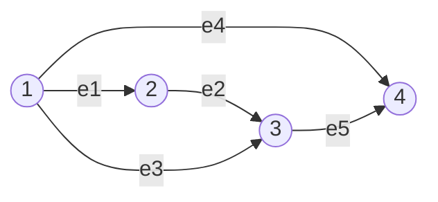

---
aliases:
  - MIT 18.06SC 1.13 Graphs, Networks, Incidence Matrices
tags:
  - course-note
---

<!-- bilingual-en:start -->
# 1.13 Graphs, Networks, Incidence Matrices
<!-- bilingual-en:end -->

*图、网络与关联矩阵*

<!-- review-entry:start -->

<!-- bilingual-en:start -->
## Recall
<!-- bilingual-en:end -->

*主动回忆*

<!-- bilingual-en:start -->
Start from the topic cues. Open a specific prompt only if needed, and try before opening its answer. The self-tests are newly constructed practice.
<!-- bilingual-en:end -->

先按主题回忆，需要时再展开具体问题，尝试后再看答案。小测为新构造的练习。

> [!info] Topics · 主题
> <!-- bilingual-en:start -->
> Incidence matrices; node potentials; independent edges; conserved flows.
> <!-- bilingual-en:end -->
>
> 关联矩阵；节点势；独立边；守恒流。
>
> > [!question]- Prompt 1 · 具体问题
> > <!-- bilingual-en:start -->
> > A connected graph has $n$ nodes. If $A$ is its edge-by-node incidence matrix, what does $Ax=0$ require of the node values?
> > <!-- bilingual-en:end -->
> >
> > 连通图有 $n$ 个节点，$A$ 每行对应边、每列对应节点。$Ax=0$ 要求各节点的值有什么关系？
> >
> >
> > > [!success]- Answer · 答案
> > > <!-- bilingual-en:start -->
> > > Every edge has zero endpoint difference, so all node values agree. $N(A)=\operatorname{span}\{\mathbf1\}$. See [[#2. Node potentials and the nullspace|the path argument]].
> > > <!-- bilingual-en:end -->
> > >
> > > 每条边两端值相同，沿路径传递就得到全部节点相等，故 $N(A)=\operatorname{span}\{\mathbf1\}$。见[[#2. Node potentials and the nullspace|沿路径的证明]]。
>
> > [!question]- Prompt 2 · 具体问题
> > <!-- bilingual-en:start -->
> > When $y$ lists signed edge flows, what does one coordinate of $A^Ty=0$ say at a node?
> > <!-- bilingual-en:end -->
> >
> > $y$ 记录带正负号的边流量时，$A^Ty=0$ 的一个分量在对应节点上表达什么？
> >
> >
> > > [!success]- Answer · 答案
> > > <!-- bilingual-en:start -->
> > > It says inflow minus outflow is zero. See [[#4. Conserved flows and the left nullspace|the node balance equations]].
> > > <!-- bilingual-en:end -->
> > >
> > > 它表示流入减流出为零。见[[#4. Conserved flows and the left nullspace|节点平衡式]]。
>
> > [!question]- Prompt 3 · 具体问题
> > <!-- bilingual-en:start -->
> > Why must the incidence rows of the edges around one cycle be linearly dependent?
> > <!-- bilingual-en:end -->
> >
> > 为什么一个环上的边所对应的关联矩阵行一定线性相关？
> >
> >
> > > [!success]- Answer · 答案
> > > <!-- bilingual-en:start -->
> > > Traverse the cycle, choosing signs according to edge orientation. Each node appears once with each sign, so the signed row sum is zero. See [[#3. Trees select independent rows|cycle dependence]].
> > > <!-- bilingual-en:end -->
> > >
> > > 沿环走一周，按参考方向决定正负，每个节点一正一负相消，所以带符号的行和为零。见[[#3. Trees select independent rows|环产生依赖]]。
>

<!-- bilingual-en:start -->
## Quick self-test
<!-- bilingual-en:end -->

*快速自测，约 5–10 分钟*

> [!example] Test 1 · 小测
> <!-- bilingual-en:start -->
> A graph has nodes $1,2,3,4$ and only the edges $1\to2$ and $3\to4$. Write its incidence matrix and a basis for $N(A)$.
> <!-- bilingual-en:end -->
>
> 图有节点 $1,2,3,4$，只有边 $1\to2$ 和 $3\to4$。写出关联矩阵及 $N(A)$ 的一组基。
>
>
> > [!question]- Hint · 提示
> > <!-- bilingual-en:start -->
> > Write one difference equation for each edge. Check which node values can still vary independently.
> > <!-- bilingual-en:end -->
> >
> > 每条边写一个差值方程，再看哪些节点值仍可独立变化。
>
> > [!success]- Solution and checks · 解答与核对
> > <!-- bilingual-en:start -->
> > $$A=\begin{pmatrix}-1&1&0&0\\0&0&-1&1\end{pmatrix},\quad
> > N(A)=\operatorname{span}\{(1,1,0,0)^T,(0,0,1,1)^T\}.$$
> > The two components can take different constants. Check $Ax=0$ and explain why these exhaust the solutions. See [[#2. Node potentials and the nullspace|the component condition]].
> > <!-- bilingual-en:end -->
> >
> > 两个连通分量可以取不同常数。核对乘积为零，并说明为何没有其他解。见[[#2. Node potentials and the nullspace|连通分量条件]]。

> [!example] Test 2 · 小测
> <!-- bilingual-en:start -->
> For the three edges $1\to2$, $2\to3$, $1\to3$, find all conserved flows $y$ satisfying $A^Ty=0$.
> <!-- bilingual-en:end -->
>
> 三条边为 $1\to2$、$2\to3$、$1\to3$。求满足 $A^Ty=0$ 的全部守恒流 $y$。
>
>
> > [!question]- Hint · 提示
> > <!-- bilingual-en:start -->
> > At node 2, compare flow on the first two edges; then balance node 1.
> > <!-- bilingual-en:end -->
> >
> > 先在节点 2 比较前两条边的流量，再写节点 1 的平衡式。
>
> > [!success]- Solution and checks · 解答与核对
> > <!-- bilingual-en:start -->
> > The node equations are $-y_1-y_3=0$, $y_1-y_2=0$, $y_2+y_3=0$, giving $y=t(1,1,-1)^T$, $t\in\mathbb R$. The negative sign means flow opposite the reference arrow on edge 3. Check every node and retain the arbitrary scalar. See [[#4. Conserved flows and the left nullspace|signed cycles]].
> > <!-- bilingual-en:end -->
> >
> > 节点方程为 $-y_1-y_3=0$、$y_1-y_2=0$、$y_2+y_3=0$，所以全部解为 $y=t(1,1,-1)^T$。第三分量的负号表示逆参考箭头流动。要核对所有节点并保留任意系数。见[[#4. Conserved flows and the left nullspace|带符号的环]]。

<!-- review-entry:end -->

<!-- bilingual-en:start -->
## 1. Encode a graph as a matrix
<!-- bilingual-en:end -->

*一条边对应一行，一个节点对应一列*

<!-- bilingual-en:start -->
The [[关联矩阵势差映射|incidence matrix]] turns the connections of a graph into a linear map. In this course, $A\in\mathbb R^{m\times n}$ has $m$ edge rows and $n$ node columns. An edge from node $i$ to node $j$ has $-1$ in column $i$, $+1$ in column $j$, and zeros elsewhere. The reference arrows specify positive signs; they do not prohibit a negative flow.

The lecture uses four nodes and five edges:
<!-- bilingual-en:end -->

[[关联矩阵势差映射|关联矩阵]]把图的连接关系变成线性映射。本课约定 $A\in\mathbb R^{m\times n}$ 有 $m$ 条边对应的行、$n$ 个节点对应的列。边从 $i$ 指向 $j$，则第 $i$ 列写 $-1$，第 $j$ 列写 $+1$，其余为零。箭头只规定正负方向，并不禁止负流量。

原课使用四个节点、五条边：

$$
A=\begin{pmatrix}
-1&1&0&0\\
0&-1&1&0\\
-1&0&1&0\\
-1&0&0&1\\
0&0&-1&1
\end{pmatrix}.
$$

<!-- bilingual-en:start -->
For a loop-free graph, each row has exactly two nonzero entries, so large incidence matrices are sparse. Some books use the transpose convention; check what the rows represent before applying a formula.
<!-- bilingual-en:end -->

无自环图的每行恰有两个非零元，因此大型关联矩阵通常稀疏。有的书把这个定义转置使用，套公式前先确认行代表什么。

<!-- bilingual-en:start -->
## 2. Node potentials and the nullspace
<!-- bilingual-en:end -->

*零空间是不改变边差值的整体平移*

<!-- bilingual-en:start -->
Let $x_i$ be a value assigned to node $i$, such as its potential or height. Multiplication produces endpoint differences:
$$Ax=\begin{pmatrix}x_2-x_1\\x_3-x_2\\x_3-x_1\\x_4-x_1\\x_4-x_3\end{pmatrix}.$$
Thus $Ax=0$ makes the two values on every edge equal. Because this graph is connected, following a path proves that all four values agree:
$$N(A)=\operatorname{span}\{(1,1,1,1)^T\},\quad \dim N(A)=1,\quad r=4-1=3.$$
Adding one constant to every node leaves every difference unchanged. Grounding a node means choosing one value, often zero, to select a representative of that family.
<!-- bilingual-en:end -->

令 $x_i$ 为节点 $i$ 的势、位置高度等数值。$Ax$ 的各分量是对应边终点减起点。$Ax=0$ 使每条边两端相等；图连通，所以沿路径传递就得到四个值相同。零空间由全一向量张成，零度为 $1$，秩为 $4-1=3$。

给所有节点同时加一个常数不会改变任何差值。Grounding（接地）就是固定某节点的值，通常取零，从这一族等价描述中选一个代表。

<!-- bilingual-en:start -->
For a disconnected graph with $c$ components, the value is constant **within each component**, but different components can have different constants. Component-indicator vectors form a basis for $N(A)$, so nullity is $c$ and rank is $n-c$. Connectedness is essential to the statement “all node values agree.”
<!-- bilingual-en:end -->

不连通图若有 $c$ 个分量，只能推出**每个分量内部**为常数，不同分量可取不同常数。各分量的指示向量组成 $N(A)$ 的基，所以零度为 $c$、秩为 $n-c$。“全部节点相等”需要连通条件。

<!-- bilingual-en:start -->
## 3. Trees select independent rows
<!-- bilingual-en:end -->

*环带来行依赖，生成树保留独立信息*

<!-- bilingual-en:start -->
In the example, row $3$ equals row $1$ plus row $2$: walking $1\to2\to3$ gives the same endpoint difference as $1\to3$. Likewise, row $4$ equals row $3$ plus row $5$. These are cycle relations.

Edges $1,2,4$ connect all four nodes without a cycle. Their three original rows are independent and span the row space: they form a spanning tree. A forest is acyclic; a tree is also connected. The proof that independent incidence rows are exactly acyclic edge sets is in [[关联矩阵与生成森林|incidence rows and spanning forests]].
<!-- bilingual-en:end -->

本例第 3 行等于第 1、2 行之和：走 $1\to2\to3$ 和直接走 $1\to3$ 的端点差一样；第 4 行又等于第 3、5 行之和。这就是环对应的行依赖。

边 $1,2,4$ 连通全部四个节点且不形成环，对应三条原始行无关并张成行空间，它们构成生成树。森林只要求无环，树还要求连通。独立行与无环边集的双向证明见[[关联矩阵与生成森林]]。

> [!warning] Source correction · 来源勘误
> <!-- bilingual-en:start -->
> The summary, p. 2, calls the first, second and fourth **columns** pivot columns and then calls them edges. Here these are independent **rows/edges**. The pivot columns of $A$ are $1,2,3$. Columns represent nodes.
> <!-- bilingual-en:end -->
>
> 讲义第 2 页把第 1、2、4 列称为主元列，接着又说它们是边。这里应为独立的第 1、2、4 **行／边**；$A$ 的主元列为第 1、2、3 列，列对应节点。

<!-- bilingual-en:start -->
## 4. Conserved flows and the left nullspace
<!-- bilingual-en:end -->

*左零空间让每个节点流入等于流出*

<!-- bilingual-en:start -->
Now let $y=(y_1,\ldots,y_5)^T$ record signed edge flows. At each node, $A^Ty$ calculates inflow minus outflow:
$$A^Ty=\begin{pmatrix}-y_1-y_3-y_4\\y_1-y_2\\y_2+y_3-y_5\\y_4+y_5\end{pmatrix}.$$
Setting this to zero gives Kirchhoff's current law, with no external injection. Two solutions are
$$q_1=(1,1,-1,0,0)^T,\qquad q_2=(0,0,1,-1,1)^T.$$
They are independent, and $\dim N(A^T)=m-r=5-3=2$, so every conserved flow is $\alpha q_1+\beta q_2$.
<!-- bilingual-en:end -->

改用 $y=(y_1,\ldots,y_5)^T$ 表示各边带符号的流量，$A^Ty$ 在每个节点计算流入减流出。令它为零，就得到无外部注入时的 Kirchhoff 电流定律。

上面两条解分别绕两个三角形流动。它们无关，而左零度为 $5-3=2$，所以任意守恒流均为 $\alpha q_1+\beta q_2$。

<!-- bilingual-en:start -->
The outer cycle has vector $q_1+q_2=(1,1,0,-1,1)^T$: the common edge cancels. Count **independent cycle vectors**, not every visible loop. For $c$ components,
$$\dim N(A^T)=m-n+c.$$
For this connected graph it is $m-n+1=2$. The construction of a basis from extra edges beyond a spanning forest is in [[回路空间与守恒流|the real cycle space]].
<!-- bilingual-en:end -->

外圈向量为 $q_1+q_2=(1,1,0,-1,1)^T$，共用边上的流量相消。因此要数**独立环向量**，不能数所有看见的圈。含 $c$ 个分量时，左零度为 $m-n+c$；本例连通，得到 $m-n+1=2$。从生成森林外的边构造基，见[[回路空间与守恒流]]。

<!-- bilingual-en:start -->
## 5. Read all four spaces on the graph
<!-- bilingual-en:end -->

*从图直接读出四个空间*

<!-- bilingual-en:start -->
| Space | What its vectors describe | Dimension in this example |
|---|---|---:|
| $N(A)\subseteq\mathbb R^4$ | Constant node potentials | $1$ |
| $C(A)\subseteq\mathbb R^5$ | Edge differences arising from node values | $3$ |
| $N(A^T)\subseteq\mathbb R^5$ | Conserved signed edge flows | $2$ |
| $C(A^T)\subseteq\mathbb R^4$ | Node vectors whose coordinates sum to zero | $3$ |
<!-- bilingual-en:end -->

<!-- bilingual-en:start -->
For $b\in C(A)$, edge differences telescope around the cycles:
$$b_3=b_1+b_2,\qquad b_4=b_3+b_5.$$
These conditions are also sufficient: choose $x_1=0$, $x_2=b_1$, $x_3=b_3$, $x_4=b_4$, then check every edge. They are exactly $q_1^Tb=q_2^Tb=0$.

Each incidence row sums to zero, so every row-space vector does too. This sum-zero hyperplane has dimension $3$, equal to the rank, proving it is the whole row space. The same conclusion follows from $C(A^T)=N(A)^\perp$.
<!-- bilingual-en:end -->

四个空间依次描述常数节点势、可实现的边差值、守恒边流，以及坐标和为零的节点向量。边差值沿环相加必须相消，所以列空间满足上面两个等式。它们也充分：取 $x_1=0,x_2=b_1,x_3=b_3,x_4=b_4$，逐边代入即可。这正是 $q_1^Tb=q_2^Tb=0$。

每条关联矩阵行的元素和为零，其线性组合仍如此；坐标和为零的超平面维数为 $3$，与秩相同，所以就是整个行空间。也可用 $C(A^T)=N(A)^\perp$ 理解。

<!-- bilingual-en:start -->
## 6. Exercise 12.1: the square network
<!-- bilingual-en:end -->

*方形网络与不在行空间的证明*

<!-- bilingual-en:start -->
For the problem's edges $1\to2,2\to3,4\to3,1\to4$,
$$A=\begin{pmatrix}-1&1&0&0\\0&-1&1&0\\0&0&1&-1\\-1&0&0&1\end{pmatrix},\quad
Ax=\begin{pmatrix}x_2-x_1\\x_3-x_2\\x_3-x_4\\x_4-x_1\end{pmatrix}.$$
The graph is connected, so $N(A)=\operatorname{span}\{(1,1,1,1)^T\}$. To prove that $e_1=(1,0,0,0)^T$ is **not** in the row space, use a necessary property of every row-space vector: it must be perpendicular to every nullspace vector. Here
$$e_1^T(1,1,1,1)^T=1\ne0.$$
One nonzero dot product is enough to disprove membership. Equivalently, every row-space vector has coordinate sum zero, but $e_1$ has sum one.
<!-- bilingual-en:end -->

原题边为 $1\to2,2\to3,4\to3,1\to4$，按方向得到上述矩阵与差值。图连通，零空间仍由全一向量张成。

要证明 $e_1=(1,0,0,0)^T$ **不在行空间**，应先说明必要条件：行空间内的向量与每个零空间向量正交。但 $e_1$ 与全一向量点积为 $1$，所以不满足条件。这一个非零点积就足以否定成员关系。也可说每条行空间向量坐标和为零，而 $e_1$ 的和为一。

<!-- bilingual-en:start -->
## 7. Exercise 12.2: compose the maps
<!-- bilingual-en:end -->

*把物理描述翻译成矩阵乘法与解方程*

<!-- bilingual-en:start -->
Continue with the square matrix from Exercise 12.1 and $C=\operatorname{diag}(1,2,2,1)$. The positive diagonal entries are edge conductances. If positive current follows the reference arrow, Ohm's law gives $y=-CAx$, because current follows a drop in potential. If $f$ denotes external injection, conservation gives $A^Ty=-f$. Combining them yields the [[加权图 Laplacian|weighted graph Laplacian]] system:
$$Lx=f,\quad L=A^TCA=
\begin{pmatrix}2&-1&0&-1\\-1&3&-2&0\\0&-2&4&-2\\-1&0&-2&3\end{pmatrix}.$$
The summary uses $y=CAx$ and $A^Ty=f$ instead. Both algebraic conventions give $A^TCAx=f$; keep the meanings of signs consistent. Exercise 12.2 explicitly uses $y=-CAx$.
<!-- bilingual-en:end -->

继续使用 12.1 的方形关联矩阵，令 $C=\operatorname{diag}(1,2,2,1)$，正对角元代表各边电导。若电流沿箭头为正，由高势流向低势便给出 $y=-CAx$；若 $f$ 表示外部注入，则节点守恒为 $A^Ty=-f$。合起来就是[[加权图 Laplacian|加权图拉普拉斯]]方程 $A^TCAx=f$。

Summary 写作 $y=CAx$、$A^Ty=f$，代数合成相同，但不能混用正负号的含义。12.2 原题明确采用 $y=-CAx$。

<!-- bilingual-en:start -->
For $f=(1,0,-1,0)^T$, ground node $3$ by setting $x_3=0$. The independent equations are
$$2x_1-x_2-x_4=1,\quad -x_1+3x_2=0,\quad -x_1+3x_4=0.$$
Hence $x_2=x_4=x_1/3$, so $4x_1/3=1$ and
$$x=(3/4,1/4,0,1/4)^T,\qquad y=-CAx=(1/2,1/2,1/2,1/2)^T.$$
The unused third equation also holds. Every potential solution is $x+t\mathbf1$, but $y$ is unchanged. The mathematical work is composing three linear maps, fixing a free constant, and solving the remaining system.
<!-- bilingual-en:end -->

取 $f=(1,0,-1,0)^T$，固定 $x_3=0$，其余独立方程如上。后两式给出 $x_2=x_4=x_1/3$，代回得到 $x_1=3/4$，继而得到势向量与四条边均为 $1/2$ 的流量。剩余第三个方程也成立。

所有势解为 $x+t\mathbf1$，但对应电流不变。这里实际用到的数学是三个线性映射的复合、固定一个自由常数，再求解线性方程组。

> [!warning] Source correction · 来源勘误
> <!-- bilingual-en:start -->
> The official solution, PDF p. 2, prints $[A^T\mid f]$ in the row-reduction step. It must be $[A^TCA\mid f]=[L\mid f]$. The displayed $L$, final potentials and final currents are correct.
> <!-- bilingual-en:end -->
>
> 官方解答 PDF 第 2 页消元处误印为 $[A^T\mid f]$，应为 $[A^TCA\mid f]=[L\mid f]$。它给出的 $L$、最终势和电流正确。

<!-- bilingual-en:start -->
## Sources and continuation
<!-- bilingual-en:end -->

*来源与后续*

<!-- bilingual-en:start -->
SC Session 1.13 corresponds to original Lecture 12, hence filenames Ses1.12 and Problems 12.1–12.2. The lecture and summary support the five-edge example and its four spaces; the problems and solutions support the square network. Source slips are identified above. The short tests, component extension and complete proofs were checked independently.
<!-- bilingual-en:end -->

SC 1.13 对应原 Lecture 12，所以文件名沿用 Ses1.12、题号为 12.1–12.2。讲课与 Summary 支持五边示例及四空间；原题与解答支持方形网络。来源笔误已在正文指出。小测、分量推广和完整证明另行核验。

- [[01_Math/02_linear algebra/MIT_OCW_18.06SC_PDF/05_Session_Summaries/MIT18_06SCF11_Ses1.12sum.pdf|Session summary]] · [[01_Math/02_linear algebra/MIT_OCW_18.06SC_PDF/06_Lecture_Transcripts/U1_S13_Lecture_Graphs_Networks_Incidence_Matrices.pdf|Lecture transcript]]
- [[01_Math/02_linear algebra/MIT_OCW_18.06SC_PDF/03_Homework_Problems/MIT18_06SCF11_Ses1.12prob.pdf|Problems 12.1–12.2]] · [[01_Math/02_linear algebra/MIT_OCW_18.06SC_PDF/04_Homework_Solutions/MIT18_06SCF11_Ses1.12sol.pdf|Official solutions]]
- [[01_Math/02_linear algebra/MIT_OCW_18.06SC_PDF/07_Recitation_Transcripts/U1_S13_Recitation_Graphs_and_Networks.pdf|Recitation: graph kernels and trace]]

[[01.12_Matrix Spaces, Rank 1, Small World Graphs|← 1.12 Matrix Spaces]] · [[01.14_Exam 1 Review and Unit 1 Exam|1.14 Exam 1 Review →]]
