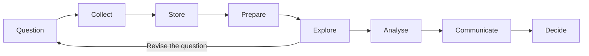

<!-- bilingual-en:start -->
# L01 — Data, Data Types and Structures
<!-- bilingual-en:end -->

### 第一讲：先把数据读对，再开始分析

<!-- review-entry:start -->
<!-- bilingual-en:start -->
## Recall
<!-- bilingual-en:end -->

> [!info] Recall · Numbers and text / 数字与文字
> <!-- bilingual-en:start -->
> Recall how a stored value can differ from its intended meaning.
> <!-- bilingual-en:end -->
> 回想：保存下来的值，可能怎样偏离原本的含义？
>
> > [!question]- Prompt · Comparing a calculated delay / 比较计算出的延误
> > <!-- bilingual-en:start -->
> > Why can `6.14 - 3.14 == 3.0` be false, and what does `abs_tol` control in `math.isclose`?
> > <!-- bilingual-en:end -->
> > 为什么这个等式可能为假？`abs_tol` 在比较时控制什么？
> >
> > > [!success]- Answer · 答案
> > > <!-- bilingual-en:start -->
> > > These decimal inputs are approximated in binary. `abs_tol` sets a permitted absolute difference, in the same unit as the values. See [[#七、小数计算有误差，比较时要考虑它|the worked comparison]].
> > > <!-- bilingual-en:end -->
> > > 这两个十进制小数用二进制近似保存。`abs_tol` 规定允许差多少，单位与原数值相同。

> [!info] Recall · Containers and operations / 容器与操作
> <!-- bilingual-en:start -->
> Recall how order, repetition and access differ between containers.
> <!-- bilingual-en:end -->
> 回想：各种容器怎样保存顺序和重复值，又怎样取值？
>
> > [!question]- Prompt · Repeated observations / 重复的观测值
> > <!-- bilingual-en:start -->
> > Three buses have delays `[0, 0, 9]`. What information is lost when this list becomes a set?
> > <!-- bilingual-en:end -->
> > 三辆公交的延误是 `[0, 0, 9]`。转成集合后丢掉了什么？
> >
> > > [!success]- Answer · 答案
> > > <!-- bilingual-en:start -->
> > > A set retains distinct values, so the second zero is lost as an observation. It also does not preserve the arrival sequence. See [[#九、容器的选择会改变保留下来的信息|containers and repeated observations]].
> > > <!-- bilingual-en:end -->
> > > 集合只保留不同取值，不能再知道有两次零延误，也不保留原来的到站顺序。

> [!info] Recall · Missing values and row identity / 缺失值与行的身份
> <!-- bilingual-en:start -->
> Recall what a row represents and which fields identify it.
> <!-- bilingual-en:end -->
> 回想：一行记录什么，又靠哪些字段认出它？
>
> > [!question]- Prompt · A journey at several stops / 一趟车经过多站
> > <!-- bilingual-en:start -->
> > If a table has one row per stop visit, why might `journey_id` alone fail to identify one row?
> > <!-- bilingual-en:end -->
> > 若每行是一次到站记录，为什么只用 `journey_id` 可能找不到唯一一行？
> >
> > > [!success]- Answer · 答案
> > > <!-- bilingual-en:start -->
> > > One journey has several stop visits. The identifier must also distinguish the stop and any reused dates or repeated visits. See [[#十三、先说清一行是什么，再整理成表格|the row-key example]].
> > > <!-- bilingual-en:end -->
> > > 同一趟车会产生多个站点的记录；还要区分站点，必要时加入日期或到访序号。

<!-- bilingual-en:start -->
## Quick self-test

These are supplementary practice questions, not official seminar exercises. Allow about 5–10 minutes; try before opening the hints or solutions.
<!-- bilingual-en:end -->

以下是补充自测，不是教师的 seminar 练习。约 5–10 分钟，先尝试，再展开提示或答案。

> [!example] Test 1 · Trace an assignment / 跟踪一次赋值
> <!-- bilingual-en:start -->
> After `a = [4, 0, 4, -2]` and `b = a.sort()`, what are `a` and `b`? Replace the second statement so that `a` keeps its initial order and `b` holds a sorted list.
> <!-- bilingual-en:end -->
> 执行这两句后，`a` 和 `b` 各是什么？怎样只改第二句，让 `a` 保留初始顺序，`b` 保存排好的列表？
>
> > [!question]- Hint · 提示
> > <!-- bilingual-en:start -->
> > Separate the operation performed on `a` from the value produced by the right-hand expression.
> > <!-- bilingual-en:end -->
> > 分开看：右边做了什么操作，又把什么值交给左边？
>
> > [!success]- Solution and check · 答案与核对
> > <!-- bilingual-en:start -->
> > `a` is `[-2, 0, 4, 4]`; `b` is `None`. Starting again from the original list, use `b = sorted(a)`. A complete explanation distinguishes mutation from the returned value. See [[#十、排序的易错点：改了列表，不等于返回列表|sorting and assignment]].
> > <!-- bilingual-en:end -->
> > `a` 为 `[-2, 0, 4, 4]`，`b` 为 `None`。从原始列表重新开始，第二句改成 `b = sorted(a)`。解释时要分清原列表的变化和返回值。

> [!example] Test 2 · Read a nested record / 读取嵌套记录
> <!-- bilingual-en:start -->
> Let `records = [{"stop": "Central"}, {"stop": "Museum"}]`. What does `records[1]["stop"]` return? Which of `(3)` and `(3,)` is a tuple?
> <!-- bilingual-en:end -->
> 给定这两条记录，表达式会取出什么？`(3)` 与 `(3,)` 中哪个是元组？
>
> > [!question]- Hint · 提示
> > <!-- bilingual-en:start -->
> > Evaluate the two bracket operations in order. For the second part, identify which punctuation creates the container.
> > <!-- bilingual-en:end -->
> > 依次处理两组方括号；第二问看哪个标点真正建立了容器。
>
> > [!success]- Solution and check · 答案与核对
> > <!-- bilingual-en:start -->
> > The result is `"Museum"`: index `1` selects the second record, then the key selects its field. `(3,)` is a tuple; `(3)` is an integer. Explain both access steps, not only the printed name. See [[#9.1 Positions and keys|positions and keys]] and [[#9.3 One-item tuples and nested changes|tuples]].
> > <!-- bilingual-en:end -->
> > 结果是 `"Museum"`：下标 `1` 选第二条，`"stop"` 再选字段。`(3,)` 是元组；`(3)` 是整数。要能解释两次取值各做了什么。

> [!example] Test 3 · Interpret a small extract / 解释一段数据
> <!-- bilingual-en:start -->
> The source defines `None` as an unrecorded delay. A day's delays are `[0, 6, None]`, with date `"2026-12-11"`. What mean can you calculate from the recorded delays? Can you determine the mean for all three buses or the time zone from these fields?
> <!-- bilingual-en:end -->
> 来源规定 `None` 表示未记录。当天延误为 `[0, 6, None]`，日期为 `"2026-12-11"`。已有记录的平均延误是多少？能否确定全部三辆车的平均延误，以及这条日期的时区？
>
> > [!question]- Hint · 提示
> > <!-- bilingual-en:start -->
> > Name which buses contribute to your numerator and denominator. Inspect exactly which date/time fields were supplied.
> > <!-- bilingual-en:end -->
> > 先说清分子、分母用了哪些车，再看来源究竟提供了哪些日期时间信息。
>
> > [!success]- Solution and check · 答案与核对
> > <!-- bilingual-en:start -->
> > The observed mean is `(0 + 6) / 2 = 3` minutes, based on two measurements. The all-bus mean is unknown; the date alone supplies no time-zone information. Retain the zero and identify both unknowns. See [[#十一、没有记录，不能直接当成零|missing values]] and [[#十二、标准让不同来源的数据能对得上|dates and standards]].
> > <!-- bilingual-en:end -->
> > 已记录的两辆车平均为 3 分钟；第三辆未知，所以全部三辆的平均值未知。只有日期也不能判断时区。核对是否保留了有效的零，并明确这两处未知。
<!-- review-entry:end -->

<!-- bilingual-en:start -->
*Lecture 1: understand the data before analysing it*
<!-- bilingual-en:end -->

<!-- bilingual-en:start -->
Suppose we want to compare the reliability of two bus routes. Before calculating average delays, we need to know what each row represents: a vehicle, a journey, or a visit to a stop. Does `0` mean on time or unrecorded? Is `00731` a route identifier or a quantity? The types and structures in this lecture help us answer these questions.
<!-- bilingual-en:end -->

假设我们想比较两条公交线路哪条更可靠。计算平均延误之前，先要弄清楚：每行记录的是一辆车、一次行程，还是一次到站？`0` 是准点，还是没有记录？`00731` 是线路编号，还是可以拿来做加减的数量？这节课讲的各种类型和结构，都是为了把这些问题说清楚。

<!-- bilingual-en:start -->
## Scope and source locations
<!-- bilingual-en:end -->

### 阅读范围与材料定位

<!-- bilingual-en:start -->
> [!note] Lecture and seminar
> **L01** is the Week 1 lecture note. **S01** is the filename prefix for Week 1 seminar notes. The seminar's Python refresher and Git/Colab tasks are in the original [Lab 1 notebook](2026_Course_Materials/03_Seminars/Week_01/1_st445_week1_lab1.ipynb) and [[ST445 - Week 01 - GitHub and Colab Lab.pdf|GitHub and Colab lab]]. Follow those materials in their own order.
<!-- bilingual-en:end -->

本篇是 **L01（Week 1 Lecture）**。Week 1 Seminar 笔记使用 **S01** 前缀；Python 复习与 Git/Colab 操作按上面的原始实验材料阅读。

<!-- bilingual-en:start -->
These notes cover Lecture 1 on 29 September 2026. Page references use the current **75-page deck**. At approximately **01:56:32–01:56:44**, the lecturer assigns GitHub to the seminar, so the GitHub procedures on pages 57–74 are outside the recorded lecture covered here. The bus examples connect the concepts; the text distinguishes them from examples in the slides.
<!-- bilingual-en:end -->

本笔记对应 2026-09-29 的 Lecture 1。页码使用当前 **75 页版**讲义。教师在录屏约 **01:56:32–01:56:44** 说明 GitHub 放到 seminar 讲，因此第 57–74 页的 GitHub 操作不列入本讲已讲内容。公交例子是串联概念的补充例子；讲义原例和补充说明在正文中分别标明。

<!-- bilingual-en:start -->
Recording times are approximate locations found in the Echo360 transcript. Transcription can misrecognise numbers and terminology, so definitions, code and formulas were also checked against the slides and executed examples. No matching explanation for pages 53–54 was located in the transcript; that material is presented as a slide-based supplement without an invented timestamp.
<!-- bilingual-en:end -->

录屏时间由 Echo360 字幕定位，都是近似范围。字幕中的数字和术语可能有错，本文的定义、代码和公式同时对照讲义与实际运行结果。第 53–54 页的表格与 tidy data 未在字幕中定位到对应讲解，以下明确按讲义补充，不为它们编造时间戳。

| 内容                                                              | PPT 页码 | Echo360 位置                                    |
| ----------------------------------------------------------------- | -------- | ----------------------------------------------- |
| [[#一、这节课在整个分析流程中的位置\|课程主线]]                   | 10–11    | 00:48:18–00:50:29                               |
| [[#二、数字有了背景，才知道能回答什么\|数据与信息]]               | 16–18    | 01:06:05–01:10:28                               |
| [[#三、大数据的难点不只有数量\|大数据的三个 V]]                   | 24–26    | 01:16:56–01:19:52                               |
| [[#四、先看记录的结构，再看文件放在哪里\|结构与 schema]]          | 29–31    | 01:22:46–01:28:46                               |
| [[#五、类型要按含义来选\|基本类型与编号]]                         | 32、45   | 01:29:00–01:30:13                               |
| [[#六、整数能装多大，取决于表示方式\|位宽与溢出]]                 | 34–38    | 01:31:23–01:43:32                               |
| [[#七、小数计算有误差，比较时要考虑它\|浮点数]]                   | 39、48   | 01:43:34–01:44:57；01:54:46–01:56:24 为标准概述 |
| [[#八、文字、码点和字节是不同的东西\|文字编码]]                   | 40、50   | 01:45:04–01:47:16                               |
| [[#九、容器的选择会改变保留下来的信息\|Python 容器]]              | 41–42    | 01:47:16–01:49:32                               |
| [[#十、排序的易错点：改了列表，不等于返回列表\|sort 与 sorted]]   | 43–44    | 01:49:36–01:52:49                               |
| [[#十一、没有记录，不能直接当成零\|缺失值]]                       | 45–46    | 01:53:01–01:54:37                               |
| [[#十二、标准让不同来源的数据能对得上\|日期与标准代码]]           | 47–52    | 01:54:46–01:56:24                               |
| [[#十三、先说清一行是什么，再整理成表格\|表格、tidy data 与键]]   | 53–54    | 未定位到对应口头讲解                            |
| [[#十四、使用数据前，还要问来源和使用条件\|来源、许可与可识别性]] | 55       | 01:56:47–01:57:36                               |

- [[ST445 - Week 01 - Lecture.pdf|教师讲义]]
- [Echo360：ST445 Week 1，2026-09-29](https://echo360.org.uk/media/4ce70ea5-3820-4059-8257-0c1dd336c212/public)
- [Moodle：Week 1](https://moodle.lse.ac.uk/course/section.php?id=347354)

<!-- bilingual-en:start -->
## 1. Where this lecture fits in the analysis process
<!-- bilingual-en:end -->

### 一、这节课在整个分析流程中的位置

[[ST445 - Week 01 - Lecture.pdf#page=10|PPT pp. 10–11]] · [Echo360 ~00:48:18–00:50:29](https://echo360.org.uk/media/4ce70ea5-3820-4059-8257-0c1dd336c212/public)

<!-- bilingual-en:start -->
The course starts with a question. We then collect, store, prepare, explore and analyse data, and communicate the result. Exploration may reveal that the available data cannot answer the original question. We may need more data or a revised question, so the process includes going back to earlier steps.
<!-- bilingual-en:end -->

课程的起点是一个想回答的问题。随后才是采集数据、保存数据、准备数据、探索、分析和沟通结果。探索时可能发现现有数据回答不了原问题，需要回去补数据或改问题，所以这些步骤会来回走。



<!-- bilingual-en:start -->
Lecture 1 focuses on the work before analysis: storing and interpreting records while preserving their meaning. Reading a route identifier as an integer loses its leading zeros. Turning two valid zero-delay observations into one set element changes the mean. Later calculations can follow the code perfectly and still answer the wrong question.
<!-- bilingual-en:end -->

第一讲主要解决分析之前的问题：怎样保存和解释记录，才能保留它本来的意思。比如，线路编号被读成整数会丢掉前导零；两个有效的零延误被集合合成一个，会改变平均数。后面的计算即使完全按代码执行，结论也可能已经偏了。

<!-- bilingual-en:start -->
## 2. Context tells us what a value can answer
<!-- bilingual-en:end -->

### 二、数字有了背景，才知道能回答什么

[[ST445 - Week 01 - Lecture.pdf#page=16|PPT pp. 16–18]] · [Echo360 ~01:06:05–01:10:28](https://echo360.org.uk/media/4ce70ea5-3820-4059-8257-0c1dd336c212/public)

<!-- bilingual-en:start -->
The slides begin with `37.9`. On its own, this value does not tell us what was measured, its unit, the subject or the time. Those details make interpretation possible. The lecture uses **data** for recorded facts or values, and **information** for data that has been organised and interpreted so it can support a judgement.
<!-- bilingual-en:end -->

讲义先给出 `37.9`。单看这个数字，不知道它测量了什么，也不知道单位、对象和时间。补上这些背景后，才知道应怎样解释它。课上用 **data** 指记录下来的事实或数值，用 **information** 指经过组织、解释后，能够支持判断的信息。

<!-- bilingual-en:start -->
Additional example: 80 people attend class A and 60 attend class B. This does not establish which attendance rate is higher; we also need each class's total enrolment. If the totals are 100 and 60, the rates are 80% and 100%. **Define the numerator, denominator and population before comparing rates.** For buses, an on-time rate based on all journeys means something different from one based only on journeys with recorded arrival times.
<!-- bilingual-en:end -->

补充例子：A 班有 80 人到课，B 班有 60 人到课，不能直接断定 A 班出勤率更高。还缺各班总人数。若 A 班有 100 人、B 班有 60 人，出勤率分别是 80% 和 100%。**先说清指标的分子、分母和对象，再比较大小。** 公交准点率也一样：分母是全部行程，还是有到站记录的行程，会改变结论的含义。

<!-- bilingual-en:start -->
## 3. Big data involves more than size
<!-- bilingual-en:end -->

### 三、大数据的难点不只有数量

[[ST445 - Week 01 - Lecture.pdf#page=25|PPT pp. 24–26]] · [Echo360 ~01:16:56–01:19:52](https://echo360.org.uk/media/4ce70ea5-3820-4059-8257-0c1dd336c212/public)

<!-- bilingual-en:start -->
The slides describe three common difficulties using the three Vs. In a bus-data example:
<!-- bilingual-en:end -->

讲义用三个 V 概括大数据常见的困难。用公交数据来理解：

<!-- bilingual-en:start -->

| Concept  | Question                                                           | Bus example                                                           |
| -------- | ------------------------------------------------------------------ | --------------------------------------------------------------------- |
| Volume   | How much data must we store and process?                           | Arrival records for many routes over several years                    |
| Velocity | How quickly does data arrive, and how quickly must results update? | Continuous location updates used for arrival predictions              |
| Variety  | How many sources and representations must we handle?               | Arrival tables, JSON location messages, passenger comments and photos |

<!-- bilingual-en:end -->

| 概念               | 要问的问题            | 公交例子                   |
| ---------------- | ---------------- | ---------------------- |
| Volume，数据量       | 有多少数据要保存和处理？     | 多年、多条线路的全部到站记录         |
| Velocity，到达与处理速度 | 数据来得多快，需要多快更新结果？ | 持续收到位置更新，并及时更新预计到站时间   |
| Variety，多样性      | 要处理多少种来源和表示方式？   | 到站表格、JSON 位置消息、乘客评论和照片 |
|                  |                  |                        |

<!-- bilingual-en:start -->
Velocity concerns data arrival and processing, rather than simply how fast a bus travels. The recording also mentions additional Vs, but the deck's core definition uses these three. There is no single file-size threshold supplied here that determines whether every dataset is big data.
<!-- bilingual-en:end -->

这里的 velocity 指数据流入和处理的速度，不能只按公交车开得快慢理解。录屏还提到扩展的 V，但这份讲义的核心定义是以上三个；不要把某一个文件大小当成判断大数据的统一门槛。

<!-- bilingual-en:start -->
## 4. Look at the structure of the records
<!-- bilingual-en:end -->

### 四、先看记录的结构，再看文件放在哪里

[[ST445 - Week 01 - Lecture.pdf#page=29|PPT pp. 29–31]] · [Echo360 ~01:22:46–01:28:46](https://echo360.org.uk/media/4ce70ea5-3820-4059-8257-0c1dd336c212/public)

<!-- bilingual-en:start -->
A **schema** describes the agreed structure of records: their fields, types and organisation. Structured data follows explicit fields. Semi-structured data has keys or tags but can vary between records and contain nested records. Unstructured content needs further interpretation before the fields needed for analysis can be extracted.
<!-- bilingual-en:end -->

**Schema** 可以理解为记录的约定：有哪些字段，每个字段是什么类型，以及它们怎样组织。结构化数据按明确字段保存；半结构化数据有键或标签，但记录可以不同、可以嵌套；非结构化内容需要进一步解释，才能提取我们要分析的字段。

<!-- bilingual-en:start -->

| Type            | Example                                               | What to check                                                           |
| --------------- | ----------------------------------------------------- | ----------------------------------------------------------------------- |
| Structured      | A table with route, stop, time and delay fields       | Missing values, incorrect values and inconsistent units can still occur |
| Semi-structured | JSON messages with varying location and device fields | Keys, absent fields and nested levels                                   |
| Unstructured    | A passenger comment, photograph or audio recording    | Which information needs to be extracted from the content                |

<!-- bilingual-en:end -->

| 类型 | 例子 | 使用时要注意什么 |
|---|---|---|
| 结构化 | 每行都有线路、站点、时间和延误的表格 | 仍然可能有缺失、错值或单位不一致 |
| 半结构化 | JSON：一条消息含位置，另一条还含设备信息 | 按键取值，检查缺少的键和嵌套层次 |
| 非结构化 | 一段乘客评论、一张照片、一段录音 | 先决定要从内容中提取什么 |

<!-- bilingual-en:start -->
Putting free text in an Excel column gives it a tabular container, but does not automatically turn the meaning of the comments into fixed fields. Structure depends on how content follows a schema, not on whether clustering is easy. A real dataset can combine structured fields, JSON and free text, as shown on slide 31.
<!-- bilingual-en:end -->

把自由文本放进 Excel 的一列，只是给它加了表格外壳；评论里的意思不会因此自动变成固定字段。判断结构时，关键是内容是否按明确的字段约定组织，不能用“容易不容易聚类”来定义。一个实际数据集也可以同时包含结构化字段、JSON 和自由文本，讲义第 31 页就是这种混合例子。

<!-- bilingual-en:start -->
## 5. Choose a type according to what the value means
<!-- bilingual-en:end -->

### 五、类型要按含义来选

[[ST445 - Week 01 - Lecture.pdf#page=32|PPT pp. 32, 45]] · [Echo360 ~01:29:00–01:30:13](https://echo360.org.uk/media/4ce70ea5-3820-4059-8257-0c1dd336c212/public)

<!-- bilingual-en:start -->
Although `"00731"` contains only digits, it is a route identifier. We need to compare it with other identifiers and use it to look up records; averaging route identifiers has no useful meaning. Converting it to an integer gives `731` and loses the leading zeros. This field should therefore remain a string, `str`.
<!-- bilingual-en:end -->

`"00731"` 虽然全是数字字符，含义却是线路编号。我们需要比较编号是否相同、用它查找记录，并不需要计算两个编号的平均值。转成整数会得到 `731`，丢掉前导零。因此这个字段应保留为字符串 `str`。

<!-- bilingual-en:start -->
Start with the intended use: integers for counts, floating-point values for measurements needing fractions, booleans for true/false conditions, strings for identifiers and text, and explicit date/time representations for time. Also check units, possible ranges and missing-value conventions. Looking numeric is not enough to justify a numeric conversion.
<!-- bilingual-en:end -->

类型选择可以从用途出发：计数通常用整数；需要小数的测量常用浮点数；真假判断用布尔值；编号和文字用字符串；时间使用明确的日期时间表示。还要检查单位、可能的取值范围和缺失值规则。字段看起来像数字，并不是把它转成数字的充分理由。

<!-- bilingual-en:start -->
## 6. An integer's range depends on how it is stored
<!-- bilingual-en:end -->

### 六、整数能装多大，取决于表示方式

[[ST445 - Week 01 - Lecture.pdf#page=34|PPT pp. 34–38]] · [Echo360 ~01:31:23–01:43:32](https://echo360.org.uk/media/4ce70ea5-3820-4059-8257-0c1dd336c212/public)

<!-- bilingual-en:start -->
A bit has two possible states, `0` and `1`; 8 bits make one byte. With `b` bits there are $2^b$ possible patterns. **The number of values** differs from **the largest value**: an unsigned 8-bit integer has 256 values, but its maximum is 255 because counting starts at zero.
<!-- bilingual-en:end -->

一个 bit 只有 `0` 和 `1` 两种状态，8 bits 是 1 byte。`b` 个 bit 一共有 $2^b$ 种组合。**组合的数量**和**最大的数值**是两回事：8 位无符号整数有 256 种取值，但因为从 0 开始，最大值是 255。

<!-- bilingual-en:start -->
Unsigned integers use their range for non-negative values. The signed integers considered here use two's complement and include negative values. For `b` bits, the ranges are:
<!-- bilingual-en:end -->

无符号整数全部用来表示非负数；这里讨论的有符号整数使用二进制补码，取值范围包含负数。对 `b` 位表示，范围分别是：

$$
\begin{aligned}
\text{unsigned:}\quad &0 \le x \le 2^b-1,\\
\text{signed, two's complement:}\quad &-2^{b-1}\le x\le 2^{b-1}-1.
\end{aligned}
$$

<!-- bilingual-en:start -->

| Representation | Minimum | Maximum |
|---|---:|---:|
| 8-bit unsigned | 0 | 255 |
| 8-bit signed | -128 | 127 |
| 32-bit unsigned | 0 | 4,294,967,295 |
| 32-bit signed | -2,147,483,648 | 2,147,483,647 |

<!-- bilingual-en:end -->

| 表示 | 最小值 | 最大值 |
|---|---:|---:|
| 8-bit unsigned | 0 | 255 |
| 8-bit signed | -128 | 127 |
| 32-bit unsigned | 0 | 4,294,967,295 |
| 32-bit signed | -2,147,483,648 | 2,147,483,647 |

<!-- bilingual-en:start -->
For example, integer temperatures reaching -20 require a type that supports negative values; pixel intensities from 0 to 255 fit in an unsigned 8-bit integer. Consider later calculations too: a type that holds every input may still be too small for their sum.
<!-- bilingual-en:end -->

例如，整数温度若可能低至 -20，就需要能表示负数的类型；0–255 的像素强度可以用 8 位无符号整数。选择前还要看将来的运算结果：原值能装下，不代表加总之后也能装下。

<!-- bilingual-en:start -->
A normal Python `int` can use more storage as the value grows. It has no fixed 8-bit or 32-bit limit, although available memory is finite. NumPy's fixed-width integers behave differently: the array operations below wrap around.
<!-- bilingual-en:end -->

Python 的普通 `int` 会按需要使用更多存储空间，没有固定的 8 位或 32 位上限，但仍受可用内存限制。NumPy 的固定宽度整数不同：下面这些数组运算会发生回绕。

```python
import numpy as np

print(255 + 1)                                   # 256
print(np.array([255], dtype=np.uint8) + 1)        # [0]
print(np.array([127], dtype=np.int8) + 1)         # [-128]
print(np.array([250], dtype=np.uint8) + 10)       # [4]
```

<!-- bilingual-en:start -->
The final result can be understood as $260\bmod256=4$. Turning a count of 260 passengers into 4 would corrupt later comparisons. Check both the data range and intermediate calculations; successful execution alone does not establish numerical correctness. These outputs describe the array operations shown, not every out-of-range conversion or every NumPy operation.
<!-- bilingual-en:end -->

最后一个结果可以用 $260\bmod256=4$ 理解。把 260 名乘客变成 4 名，会直接破坏后面的比较。检查类型时，要同时检查取值范围和中间运算；不要把“没有报错”当作“数字正确”。这些输出针对上面的数组运算，不能推断所有越界转换或所有 NumPy 操作都会以同一种方式处理。


<!-- bilingual-en:start -->
The distinction is **arbitrary-precision Python integers versus a particular fixed-width representation**, not “Python versus NumPy” in general. Fixed-width integers also exist outside NumPy. An overflow may wrap, warn or raise an error depending on the type and operation; the code above establishes only these examples.
<!-- bilingual-en:end -->

这里真正的区别是 **Python 普通整数会扩展位数，而某些整数类型的位宽固定**。固定宽度整数并不只有 NumPy 才有。越界后回绕、警告还是报错，要看具体类型和操作，不能把例子概括成“只有 NumPy 会溢出”。

<!-- bilingual-en:start -->
## 7. Allow for rounding error when comparing calculated values
<!-- bilingual-en:end -->

### 七、小数计算有误差，比较时要考虑它

[[ST445 - Week 01 - Lecture.pdf#page=39|PPT pp. 39, 48]] · [Echo360 ~01:43:34–01:44:57](https://echo360.org.uk/media/4ce70ea5-3820-4059-8257-0c1dd336c212/public)

<!-- bilingual-en:start -->
Floating-point numbers use a finite number of binary digits. Many decimal fractions cannot be represented exactly, so calculations use nearby representable values. The slides demonstrate this with `6.14 - 3.14`. If these are minutes after the same reference time, the mathematical difference is three minutes, but the computed result is:
<!-- bilingual-en:end -->

浮点数用有限的二进制位保存数值。许多十进制小数不能这样精确保存，所以计算时实际使用的是邻近的可表示值。讲义的例子是 `6.14 - 3.14`。把两者看作同一基准时刻之后的分钟数，理论上的时间差为 3 分钟，但计算结果如下：

```python
import math

delay = 6.14 - 3.14
print(delay)                                      # 2.9999999999999996
print(delay == 3.0)                               # False
print(math.isclose(delay, 3.0,
                   rel_tol=0.0, abs_tol=1e-12))   # True
```

<!-- bilingual-en:start -->
A filter using `delay == 3.0` could exclude this record from the three-minute-delay group. Preserve the original arrival data and choose the comparison rule for the analytical purpose. The `1e-12` tolerance only demonstrates numerical error; a real tolerance should reflect units, measurement precision and the difference that matters for the question.
<!-- bilingual-en:end -->

如果用 `delay == 3.0` 筛选“延误 3 分钟”的记录，这条记录就可能被排除。这里应先保留原始到站数据，再按分析目的设置比较规则。示例中的 `1e-12` 只是用来展示数值误差；实际容差要结合单位、测量精度和你要判断的差异，不能每个项目都照抄。

<!-- bilingual-en:start -->
The slide warns against comparing floats with `==`. More precisely: **when the question is approximate mathematical equality, do not automatically require the stored results to be exactly equal.** Some values are exactly representable, and some tasks do require exact equality. The comparison must match the question. Supplementary check: [Python's floating-point explanation](https://docs.python.org/3/tutorial/floatingpoint.html).
<!-- bilingual-en:end -->

讲义用“不要用 `==` 比较浮点数”作提醒。更准确地说：**当你想判断的是数学上的近似相等时，不要直接要求两个浮点结果逐位相同。** 某些值可以精确表示，某些任务也确实需要精确相等；关键是比较规则要符合问题。补充核验：[Python 浮点数说明](https://docs.python.org/3/tutorial/floatingpoint.html)。

<!-- bilingual-en:start -->
Slide 48 shows another risk. A standard 64-bit binary float can represent every integer from $-2^{53}$ to $2^{53}$ exactly. Beyond that range, it cannot represent every consecutive integer. Some larger integers remain exactly representable; the guarantee for all consecutive integers is what ends.
<!-- bilingual-en:end -->

第 48 页还有一个不同的风险：常见的 64 位二进制浮点数能精确表示 $-2^{53}$ 到 $2^{53}$ 之间的每一个整数；超过这个范围后，就不能保证每个相邻整数都能表示。较大的某些整数仍可精确表示，不能说“超过后全都不精确”。

```python
identifier = 9007199254740993
print(float(identifier))  # 9007199254740992.0
```

<!-- bilingual-en:start -->
If this value is an ID, changing its last digit can associate the record with the wrong entity. Identifiers used for recognition and matching should remain strings when that is their source representation, rather than being converted to floats merely to make a column numeric.
<!-- bilingual-en:end -->

若这个数是 ID，最后一位变化就可能把记录关联到错误的对象。只需要识别和匹配的 ID，应按来源规则保留为字符串；不要为了“统一成数字”而转成浮点数。


<!-- bilingual-en:start -->
### 7.1 Read the two tolerances as a comparison rule

`abs_tol` says **how much difference is allowed in the original unit**. `rel_tol` says **how large the difference may be relative to the size of the numbers**. For finite values, `math.isclose(a, b, rel_tol=r, abs_tol=s)` checks:
<!-- bilingual-en:end -->

### 7.1 两种容差分别在管什么

`abs_tol` 管“最多差多少”，单位与原数值相同；`rel_tol` 管“相对这两个数的大小，最多能差多少比例”。对有限数值，比较规则是：

$$|a-b| \leq \max\bigl(r\max(|a|,|b|),\ s\bigr).$$

<!-- bilingual-en:start -->
Here `a` and `b` are the values being compared; `r` and `s` are the two tolerance settings. First compute the absolute difference on the left. Then compare it with the larger of the relative allowance and the absolute allowance on the right. With `rel_tol=0`, the relative allowance is zero, so the earlier example simply asks whether the error is at most `1e-12` minutes.

For example, `rel_tol=0.01` permits a difference of about 1% of the larger magnitude: an allowance of 1 around 100, or 10 around 1000. Near zero, a relative allowance may be too small, so an appropriate absolute allowance matters. Neither setting changes the stored inputs. See [[浮点容差比较|relative and absolute tolerance]] for the near-zero case.
<!-- bilingual-en:end -->

`a`、`b` 是要比较的数，`r`、`s` 是两种容差。先算左边实际差了多少，再看它是否超过右边允许的差异；右边取两种允许量中较大的那个。设 `rel_tol=0` 后，相对项为零，前面的例子就只问：误差是否不超过 `1e-12` 分钟。

例如 `rel_tol=0.01` 大致允许较大绝对值的 1%：数值约 100 时允许差约 1，数值约 1000 时允许差约 10。接近零时，只靠比例可能不够，需要合适的绝对容差。这两个参数改变的是比较规则，不会修改原始数据。

<!-- bilingual-en:start -->
## 8. Text, code points and bytes are different
<!-- bilingual-en:end -->

### 八、文字、码点和字节是不同的东西

[[ST445 - Week 01 - Lecture.pdf#page=40|PPT pp. 40, 50]] · [Echo360 ~01:45:04–01:47:16](https://echo360.org.uk/media/4ce70ea5-3820-4059-8257-0c1dd336c212/public)

<!-- bilingual-en:start -->
Unicode assigns code points to text, while UTF-8 specifies how to encode those code points as bytes. For example, `é` has code point 233 and uses two UTF-8 bytes, `C3 A9`. A string's character count and encoded byte length need not be the same.
<!-- bilingual-en:end -->

Unicode 给文字分配码点，UTF-8 则规定怎样把码点写成字节。例如 `é` 的码点是 233，UTF-8 用两个字节 `C3 A9` 保存它。一个字符串有几个字符，和它编码后占几个字节，不一定相同。

```python
name = "Café"
raw = name.encode("utf-8")
print(ord("é"))             # 233
print(len(name), len(raw))   # 4 5
print(raw.hex(" "))         # 43 61 66 c3 a9
print(raw.decode("utf-8"))  # Café
print(raw.decode("latin-1"))  # Café
```

<!-- bilingual-en:start -->
Decoding the same bytes with the wrong rule can produce different text without raising an error. If arrival records contain `Café` but a stop reference table is decoded as `Café`, a name-based join will fail. Confirm the file's actual encoding and use that rule when reading it; UTF-8 being common does not make it the encoding of every file.
<!-- bilingual-en:end -->

同一串字节用错解码规则，可能得到另一段文字，而且不一定报错。如果到站表写的是 `Café`，站点资料表却被读成 `Café`，按名称连接时就匹配不上。应确认文件的实际编码，在读取时使用正确规则；不能因为 UTF-8 常见就假定所有文件都是 UTF-8。

<!-- bilingual-en:start -->
**Matching counts are only a first check; also check which names are present.** Both sources below contain two stops, but the stop sets differ:
<!-- bilingual-en:end -->

**数量对上只是第一步，还要检查名字是否对上。** 下面两个来源都有两个站点，但站点集合不同：

```python
stops_a = {"Central", "Café"}
stops_b = {"Central", "Café"}
print(len(stops_a) == len(stops_b))  # True
print(stops_a - stops_b)            # {'Café'}
print(stops_b - stops_a)            # {'Café'}
```

<!-- bilingual-en:start -->
Sets suit the question of which stop names occur. They do not retain repeated occurrences, so this check does not verify how many arrival records exist for each stop.
<!-- bilingual-en:end -->

这里用集合检查“哪些站名出现过”很合适。但集合不保留重复出现的次数，因此不能用它核验每个站点有多少次到站记录。


<!-- bilingual-en:start -->
### 8.1 Keep the character and its encoding separate

For `é`, Unicode identifies the character as **U+00E9** (decimal 233). UTF-8 stores that code point as `C3 A9`; Latin-1 stores it as `E9`. Unicode is the character/code-point standard; UTF-8 and Latin-1 are ways of representing text as bytes. Latin-1 covers only a limited character range, so it cannot encode every Unicode character. See [[Unicode 与文本编码|code points and encodings]].
<!-- bilingual-en:end -->

### 8.1 先分清“是什么字”，再看“存成什么字节”

`é` 在 Unicode 中的码点是 **U+00E9**，十进制为 233。用 UTF-8 存，它是 `C3 A9`；用 Latin-1 存，它是 `E9`。Unicode 规定字符与码点，UTF-8、Latin-1 规定怎样表示成字节。Latin-1 能表示的字符有限，并不能保存所有 Unicode 字符。

<!-- bilingual-en:start -->
## 9. A container determines which information is retained
<!-- bilingual-en:end -->

### 九、容器的选择会改变保留下来的信息

[[ST445 - Week 01 - Lecture.pdf#page=41|PPT pp. 41–42]] · [Echo360 ~01:47:16–01:49:32](https://echo360.org.uk/media/4ce70ea5-3820-4059-8257-0c1dd336c212/public)

<!-- bilingual-en:start -->
After choosing types for individual values, we need to organise them. Here a dictionary, `dict`, holds one record, and a list holds several records:
<!-- bilingual-en:end -->

一个值选好类型后，还需要把多个值组织起来。下面用一个字典 `dict` 保存一条记录，用列表 `list` 保存多条记录：

```python
observations = [
    {"route_id": "00731", "stop": "Central", "delay_min": 3.0},
    {"route_id": "00731", "stop": "Central", "delay_min": 5.0},
    {"route_id": "00420", "stop": "Café", "delay_min": 1.0},
]
print(observations[0]["delay_min"])  # 3.0
```

<!-- bilingual-en:start -->
`observations[0]` selects the first record; `["delay_min"]` then selects its delay field. Named fields make the record easier to inspect than a list of values whose meanings must be remembered by position.
<!-- bilingual-en:end -->

`observations[0]` 先取出第一条记录，再用 `["delay_min"]` 取出其中的延误字段。这比把几列数值混在一个没有字段名的列表里更容易检查。

<!-- bilingual-en:start -->

| Container | Order and duplicates | Changes | Useful for |
|---|---|---|---|
| `list` | Ordered; duplicates allowed | Add, remove or replace elements | Keeping repeated observations in order |
| `tuple` | Ordered; duplicates allowed | Its element positions cannot be reassigned | A fixed group of values, such as coordinates |
| `dict` | Insertion order; unique keys, possibly repeated values | Update fields | Looking up values by field name |
| `set` | No positional order; unique values | Add or remove elements | Membership and differences between groups of values |
<!-- bilingual-en:end -->

| 容器 | 顺序和重复值 | 能否修改 | 适合的问题 |
|---|---|---|---|
| `list` | 保留顺序，允许重复 | 可以增删、替换元素 | 按记录顺序保留多次观测 |
| `tuple` | 保留顺序，允许重复 | 不能替换它的位置上的元素 | 固定的一组值，如坐标 |
| `dict` | 保留插入顺序；键唯一，值可重复 | 可以修改字段 | 按字段名查值 |
| `set` | 不提供位置顺序；值唯一 | 可以增删元素 | 判断是否出现、找两组值的差异 |

<!-- bilingual-en:start -->
One boundary matters: a tuple's elements cannot be reassigned, but a list contained inside a tuple can still change. Tuple immutability does not freeze every object it refers to.
<!-- bilingual-en:end -->

补充边界：tuple 不能替换元素，但其中若放了一个 list，这个 list 自身仍可能改变。“tuple 不可变”说的是 tuple 本身的位置绑定，不代表里面所有对象都被冻结。

<!-- bilingual-en:start -->
**Repeated values are not necessarily duplicate records.** `[0, 0, 9]` can represent three buses, two of which arrived on time. Converting it to `{0, 9}` loses the second on-time observation.
<!-- bilingual-en:end -->

**重复数值不一定是重复记录。** `[0, 0, 9]` 可以表示三辆公交车，其中两辆都准点。转成集合后只剩 `{0, 9}`，第二次准点观测就丢了。

```python
delays = [0, 0, 9]
unique_delays = set(delays)
print(sum(delays) / len(delays))                # 3.0
print(sum(unique_delays) / len(unique_delays))  # 4.5
```

<!-- bilingual-en:start -->
The second mean averages the distinct delay values. It no longer answers the average delay of the three buses. Before using a set, check whether the question really concerns distinct values only.
<!-- bilingual-en:end -->

第二个平均数回答的是“不同延误数值的平均是多少”，已经不是“三辆车平均延误多少”。使用集合之前，先确认问题是否真的只关心不同取值。


<!-- bilingual-en:start -->
### 9.1 Positions and keys

A list answers “which position?”; a dictionary answers “which key?”. Python sequence positions start at zero. A dictionary is a mapping, not a list with labels attached. A key can be an integer too: `d[1]` means the key `1`, not the second dictionary entry.
<!-- bilingual-en:end -->

### 9.1 下标找位置，键找字段

列表按位置取值，字典按键取值。Python 序列下标从零开始。字典是键到值的对应关系，不是“加了名字的列表”。键也可以是整数：`d[1]` 查的是键 `1`，并不是字典中的第二项。

```python
bus_records = [
    {"stop": "Central", "delay_min": 0},
    {"stop": "Museum", "delay_min": 9},
]
print(bus_records[1]["stop"])        # Museum
record = bus_records[1]
print(record["delay_min"])           # 9: lookup
record["delay_min"] = 6              # assignment: update the value
print(bus_records[1]["delay_min"])   # 6
```

<!-- bilingual-en:start -->
Read `bus_records[1]["stop"]` from left to right: select the **second** record, then select its `"stop"` field. Braces `{}` create the dictionary; brackets `[]` access an item. `record[key]` retrieves a value; `record[key] = value` assigns one. Assignment updates an existing key or adds an absent key. A dictionary preserves key insertion order, but access is still by key; see [[Python dict 顺序与查找|dictionary order and lookup]].
<!-- bilingual-en:end -->

从左往右读：`bus_records[1]` 先取**第二条**记录，`["stop"]` 再取其中的站名。花括号 `{}` 用来建立字典，方括号 `[]` 用来访问元素。`record[key]` 是查值；加上 `= value` 才是赋值，已有键会更新，没有的键会新增。字典保留键的插入顺序，但查找仍然按键进行。

<!-- bilingual-en:start -->
### 9.2 Sets keep values, not occurrence counts

`set([0, 0, 9])` keeps only the distinct values. `{"Central", "Museum"}` creates a set; **`set()` creates an empty set, whereas `{}` creates an empty dictionary**. `A - B` contains values in `A` that are absent from `B`; swapping the operands asks the opposite question.

Set elements and dictionary keys must be **hashable**: their hash must remain stable and respect equality. Ordinary lists, dictionaries and sets are not hashable. A tuple is hashable only if all its elements are hashable. A list can still contain a set, because list elements do not have this requirement. See [[Python 集合与重复观测|sets and repeated observations]] and [[哈希键语义稳定性|hashable keys]].
<!-- bilingual-en:end -->

### 9.2 集合留下取值，不留下出现次数

`set([0, 0, 9])` 只留下不同取值。`{"Central", "Museum"}` 是集合；**空集合写 `set()`，空的 `{}` 是字典**。`A - B` 找的是“在 A 里、但不在 B 里”的值，交换两边就换了问题。

集合元素和字典键必须**可哈希**：哈希值要稳定，而且与相等判断一致。普通 list、dict、set 都不可哈希；tuple 只有在每个元素都可哈希时才可哈希。不过，list 里可以放 set，因为列表对自己的元素没有这个要求。

<!-- bilingual-en:start -->
### 9.3 One-item tuples and nested changes

For a one-item tuple, the **comma** matters. Parentheses around a single number only group an expression: `(3)` is still the integer `3`, and `(3.0)` is a float. See [[Python 单元素元组|one-item tuple syntax]].
<!-- bilingual-en:end -->

### 9.3 单元素元组看逗号，嵌套修改看改了哪一层

只有一个元素时，建立元组的关键是**逗号**。仅加括号不会改变数字的类型：`(3)` 仍是整数 3，`(3.0)` 才是浮点数。

```python
print(type((3)).__name__)    # int
print(type((3,)).__name__)   # tuple
print(type((3.0)).__name__)  # float

entry = ("Central", [0, 9])
entry[1].append(4)
print(entry)                # ('Central', [0, 9, 4])
# entry[1] = [4]            # would raise TypeError
```

<!-- bilingual-en:start -->
`append` changes the list already stored inside `entry`. The commented assignment would replace what the tuple's second position refers to, which is forbidden. This tuple is also unhashable because it contains a list. See [[元组不可变边界|the boundary of tuple immutability]].
<!-- bilingual-en:end -->

`append` 改的是元组内部那个列表；注释中的赋值想替换元组第二个位置指向的对象，所以不允许。这个元组因为含有列表，也不能用作字典键或集合元素。

<!-- bilingual-en:start -->
### 9.4 Unpacking follows iteration

Unpacking assigns successive items to successive names. It is not limited to tuples. With no starred target, the number of names must match the number of items. Lists and tuples supply their elements in order. Dictionaries supply **keys** by default; `.values()` supplies values in the same insertion order. A set has no positional-order guarantee, so unpacking it should not be used to assign fixed roles.
<!-- bilingual-en:end -->

### 9.4 解包就是按迭代顺序逐个接值

解包不只用于 tuple：右边依次给出元素，左边的名字依次接住。不使用星号接收时，两边数量必须相同。list、tuple 按元素顺序提供值；dict 默认提供的是**键**，`.values()` 才提供同一插入顺序下的值。set 没有位置顺序保证，不适合用这种写法给不同角色分配值。

```python
record = {"stop": "Central", "delay_min": 0}
first, second = record
print(first, second)                 # stop delay_min
stop, delay = record.values()
print(stop, delay)                   # Central 0
stop = record["stop"]                # explicit field selection
delay = record["delay_min"]
```

<!-- bilingual-en:start -->
If a name must mean a particular field, explicit key lookup states that intention directly. See [[Python 可迭代对象解包|unpacking and iteration order]]. These container details extend slides 41–42; their precise syntax is checked against the Python documentation, not assigned a separate lecture timestamp.
<!-- bilingual-en:end -->

如果变量必须对应某个指定字段，直接按键取值最清楚。这些细节是对 pp. 41–42 的补充，语法依据 Python 文档核验，不另外编造老师逐条讲解的时间。

<!-- bilingual-en:start -->
## 10. Sorting a list and returning a list are separate actions
<!-- bilingual-en:end -->

### 十、排序的易错点：改了列表，不等于返回列表

[[ST445 - Week 01 - Lecture.pdf#page=43|PPT pp. 43–44]] · [Echo360 ~01:49:36–01:52:49](https://echo360.org.uk/media/4ce70ea5-3820-4059-8257-0c1dd336c212/public)

<!-- bilingual-en:start -->
The slides first use `shopping.Sort()` to demonstrate a case error. Python is case-sensitive; the list method is `.sort()`, so `.Sort()` raises `AttributeError`. After fixing the name, a second distinction remains: **the list changes, but the method returns `None`.**
<!-- bilingual-en:end -->

讲义先用 `shopping.Sort()` 演示大小写错误。Python 区分大小写，列表的方法叫 `.sort()`，因此 `.Sort()` 会触发 `AttributeError`。但把大小写改对后，还有一个更容易误解的地方：**列表被改了，方法返回的却是 `None`。**

<!-- bilingual-en:start -->
It is tempting to predict that both `ordered_delays` and `delays` will contain `[0, 0, 9]` after this code. Only the original list has that value.
<!-- bilingual-en:end -->

下面这段代码容易让人预测：`ordered_delays` 和 `delays` 都会变成 `[0, 0, 9]`。实际只有原列表变成了这个顺序。

```python
delays = [9, 0, 0]
ordered_delays = delays.sort()

print(ordered_delays)  # None
print(delays)          # [0, 0, 9]
```

<!-- bilingual-en:start -->
Read the assignment in two steps. First, `delays.sort()` changes `delays` directly. Then its return value is assigned to the variable on the left. That return value is `None`, so `ordered_delays` stores `None`. **Assignment takes the result of the expression on the right; it does not automatically select the object that the operation changed.**
<!-- bilingual-en:end -->

把第二行拆开理解：先执行右边的 `delays.sort()`，它直接修改 `delays`；然后把右边的返回值交给左边的变量。返回值是 `None`，所以 `ordered_delays` 保存的就是 `None`。**赋值保存的是右侧表达式的结果，不会自动去找“刚才被修改的那个对象”。**

<!-- bilingual-en:start -->
Use `sorted(delays)` when you want a sorted list while keeping the original arrival order. The example below resets the original input first: `sorted()` cannot recover an earlier order after it has already been changed.
<!-- bilingual-en:end -->

如果要保留原来的到站顺序，又要得到一个排序后的列表，就用 `sorted(delays)`。注意，下面重新设置了原始列表；不能指望 `sorted()` 把已经丢掉的原顺序恢复出来。

```python
delays = [9, 0, 0]
ordered_delays = sorted(delays)

print(ordered_delays)  # [0, 0, 9]
print(delays)          # [9, 0, 0]
```

<!-- bilingual-en:start -->

| Expression       | Original list            | Return value      |
| ---------------- | ------------------------ | ----------------- |
| `delays.sort()`  | Sorted in place          | `None`            |
| `sorted(delays)` | Keeps its original order | A new sorted list |

<!-- bilingual-en:end -->

| 写法 | 原列表 | 返回值 |
|---|---|---|
| `delays.sort()` | 原地排序 | `None` |
| `sorted(delays)` | 保留原顺序 | 新的排序列表 |

<!-- bilingual-en:start -->
List methods `.append()` and `.reverse()` also modify a list and return `None`. This does not mean every method that changes an object returns `None`: `.pop()`, for example, removes and returns an element. Check the particular method's contract. Supplementary check: [Python data structures](https://docs.python.org/3/tutorial/datastructures.html).
<!-- bilingual-en:end -->

列表的 `.append()` 和 `.reverse()` 也属于修改列表并返回 `None` 的操作。但不要推成“所有会修改对象的方法都返回 `None`”：例如 `.pop()` 会删除并返回一个元素。应查看具体方法的约定。补充核验：[Python 数据结构文档](https://docs.python.org/3/tutorial/datastructures.html)。


<!-- bilingual-en:start -->
> [!warning] `None` does not mean “nothing changed”
> `b = a.sort()` can change `a` while assigning `None` to `b`. A Python return value is also not automatically a process exit code: successful execution does not imply `return 0`. Each operation has its own return contract. See [[列表原地修改|in-place list changes]] and [[返回值与打印|how return values reach the caller]].
<!-- bilingual-en:end -->

> [!warning] 返回 `None`，不等于什么都没变
> `b = a.sort()` 会改变 `a`，同时让 `b` 得到 `None`。Python 函数的返回值也不是自动生成的进程退出码；运行成功并不意味着会 `return 0`。要看这个操作本身约定返回什么。

<!-- bilingual-en:start -->
## 11. An unrecorded value is not an observed zero
<!-- bilingual-en:end -->

### 十一、没有记录，不能直接当成零

[[ST445 - Week 01 - Lecture.pdf#page=46|PPT pp. 45–46]] · [Echo360 ~01:53:01–01:54:37](https://echo360.org.uk/media/4ce70ea5-3820-4059-8257-0c1dd336c212/public)

<!-- bilingual-en:start -->
For bus delays, `[0, 9, None]` means the first bus was on time, the second was nine minutes late, and the third has no recorded delay. We choose `None` as the missing marker here. Python's `None` represents the absence of a value; it is not the number zero. Its role depends on context: when `.sort()` returns `None`, it means no sorted list is returned, rather than reporting a missing observation.
<!-- bilingual-en:end -->

继续看公交延误：`[0, 9, None]` 表示第一辆准点、第二辆晚 9 分钟、第三辆没有延误记录。这里我们选择 `None` 表示未知值。`None` 本身是 Python 表示“没有值”的对象，并不是数字 0；它的具体含义由上下文决定。`.sort()` 返回 `None` 时，表示没有返回排序列表，不是在报告缺失观测。

<!-- bilingual-en:start -->
Replacing the third value with zero adds the specific assumption that the third bus also arrived on time. Saying that we assume the data was collected correctly does not identify the value that this replacement introduces.
<!-- bilingual-en:end -->

把第三个值填成 0，相当于补上了“第三辆也准点”这个具体假设。只说“假设数据收集正确”，还没有说出这一步究竟往数据里加了什么信息。

<!-- bilingual-en:start -->
| Calculation | Result | Interpretation |
|---|---:|---|
| Recorded buses only: $(0+9)/2$ | 4.5 minutes | Mean delay among the two buses with recorded delays |
| Fill the third with zero: $(0+9+0)/3$ | 3 minutes | Mean for three buses under the assumption that the third was on time |
| Actual mean for all three buses | Unknown | The third bus's true delay is unavailable |
<!-- bilingual-en:end -->

| 计算方式 | 结果 | 这个数能说明什么 |
|---|---:|---|
| 只计算已记录的两辆：$(0+9)/2$ | 4.5 分钟 | 两辆有记录公交车的平均延误 |
| 给第三辆填 0：$(0+9+0)/3$ | 3 分钟 | 在第三辆准点这一假设下，三辆车的平均延误 |
| 三辆车的真实平均延误 | 未知 | 还缺第三辆的真实值 |

<!-- bilingual-en:start -->
Using observed records alone does not automatically give a representative answer for all buses. If heavily delayed buses are more likely to go unrecorded, observed data may make the route look better. At minimum, report how many valid measurements support the result and how many are missing. Further treatment depends on why values are missing and what the analysis asks.
<!-- bilingual-en:end -->

只计算已有记录也不是自动正确的总体答案。例如，越晚点越容易漏报，已有记录就可能把线路表现说得过好。最少要交代结果基于多少条有效记录、缺失多少条；进一步怎样处理缺失，需要结合缺失原因和分析问题。

<!-- bilingual-en:start -->
The slides list blanks, `NA`, `N/A`, `NULL`, `None`, `-999`, `.`, `?`, `0` and `unknown` as possible missing-value spellings. They are not a universal list of values to delete. Read each source's field definitions, convert explicitly, and retain the original values and conversion rule.
<!-- bilingual-en:end -->

讲义列出空白、`NA`、`N/A`、`NULL`、`None`、`-999`、`.`、`?`、`0`、`unknown` 等写法。这些只是可能的缺失标记，不是通用删除清单。先读每个来源、每个字段的说明，再明确转换，并保留原始值和转换规则。

<!-- bilingual-en:start -->
If a source defines zero as a missing marker in a field, interpret that zero as unknown. If the same field uses zero for both on-time arrivals and missing values without another indicator, the stored zero alone cannot distinguish the two cases.
<!-- bilingual-en:end -->

如果来源规定某列的 `0` 表示缺失，这个 `0` 也应按未知处理。若同一列既用 `0` 表示准点，又用它表示缺失，却没有其他标记，仅凭这个值就无法区分两种情况。


<!-- bilingual-en:start -->
### 11.1 Remove only the values that mean missing

In this example, only `None` marks a missing value. Testing `if x` is different: zero is false in a Boolean test, so that condition would also remove valid on-time records.
<!-- bilingual-en:end -->

### 11.1 只删题目规定为缺失的值

这个例子只用 `None` 表示缺失。`if x` 检查的是真假，而零的真假值是假，因此它还会误删有效的准点记录。

```python
raw_delays = [4, 0, None, 4, -2]
kept = [x for x in raw_delays if x is not None]
print(kept)                    # [4, 0, 4, -2]
print(sorted(kept))             # [-2, 0, 4, 4]
print(raw_delays)               # [4, 0, None, 4, -2]
```

<!-- bilingual-en:start -->
Filtering and sorting are two operations. `kept` preserves the order of retained observations; `sorted(kept)` creates a separate ordered result. `x is not None` is correct for this stated convention, not a universal detector for every library's missing values.
<!-- bilingual-en:end -->

筛选和排序是两步。`kept` 保留留下来的记录顺序，`sorted(kept)` 再生成单独排好的结果。`x is not None` 适用于这里给定的缺失规则，并不能检测所有库、所有数据源中的缺失值。

<!-- bilingual-en:start -->
## 12. Standards help different sources agree on meaning
<!-- bilingual-en:end -->

### 十二、标准让不同来源的数据能对得上

[[ST445 - Week 01 - Lecture.pdf#page=47|PPT pp. 47–52]] · [Echo360 ~01:54:46–01:56:24](https://echo360.org.uk/media/4ce70ea5-3820-4059-8257-0c1dd336c212/public)

<!-- bilingual-en:start -->
A standard provides an agreed representation. IEEE 754 concerns floating-point numbers; Unicode and UTF-8 concern text; ISO 8601 concerns dates and times; ISO 3166 and ISO 4217 provide country and currency codes. Knowing the standard is not enough: confirm that the source actually follows it.
<!-- bilingual-en:end -->

这里的标准，是大家共同采用的表示约定。IEEE 754 说明浮点数的表示；Unicode 和 UTF-8 处理文字；ISO 8601 处理日期时间；ISO 3166 和 ISO 4217 分别提供国家与货币代码。知道标准后，还要确认手里的数据确实按这个标准生成。

<!-- bilingual-en:start -->
`05/10/2026` illustrates the problem. Day/month/year means 5 October; month/day/year means 10 May. Both produce a valid-looking date, so the program may not raise an error. Once the source is confirmed to use day/month/year, write the date unambiguously as `2026-10-05`.
<!-- bilingual-en:end -->

`05/10/2026` 是一个典型问题：按日/月/年读，是 10 月 5 日；按月/日/年读，是 5 月 10 日。两种结果都像合法日期，所以程序可能不会报错。确认来源采用日/月/年后，可以明确写成 `2026-10-05`。

<!-- bilingual-en:start -->
The slide's `2026-10-05T14:30Z` means 14:30 UTC on 5 October 2026. `T` separates date and time, and `Z` indicates UTC. Preserve and interpret time zones when comparing arrival timestamps from different sources. If the source contains only a date, do not invent an arrival time.
<!-- bilingual-en:end -->

讲义中的 `2026-10-05T14:30Z` 表示 2026 年 10 月 5 日 14:30 UTC。`T` 分隔日期与时间，`Z` 表示 UTC。比较不同来源的到站时刻时，要保留并正确解释时区。原始记录如果只有日期，就不要凭空补一个到站时间。

<!-- bilingual-en:start -->
The slides also note that this representation supports text sorting. That requires a consistent format, precision and time-zone offset. Strings with different offsets do not necessarily sort in chronological order; parse them and compare on a common time basis.
<!-- bilingual-en:end -->

讲义还说这种表示便于按文本排序。这个结论需要条件：表示格式、精度和时区偏移应一致。来自不同时区偏移的字符串，不能直接假定文本顺序就是时刻先后；应解析后在共同时间基准下比较。

<!-- bilingual-en:start -->
Slide 51 connects country codes to missing values: `NA` is Namibia's two-letter country code. If a loader treats it as missing, the country information is lost. Missingness depends on the field and source convention, not just the two letters.
<!-- bilingual-en:end -->

第 51 页把国家代码与缺失值问题接了起来：`NA` 是 Namibia（纳米比亚）的两字母国家代码。若读取工具把它当作“没有值”，国家信息就丢了。是否缺失，要看字段和来源约定，不能只看两个字母。

<!-- bilingual-en:start -->
The slide uses pandas' `keep_default_na=False` to disable its default missing-value markers. This is only part of the solution: after disabling defaults, specify which values really mean missing in each field according to the source documentation. Do not simply treat every blank as valid text.
<!-- bilingual-en:end -->

讲义用 pandas 的 `keep_default_na=False` 展示如何停止使用默认缺失标记。这个开关只是工具的一部分：关闭默认规则后，仍要按来源说明指定哪些字段、哪些值确实缺失，不能把所有空白都当成有效文字。

<!-- bilingual-en:start -->
Putting these decisions together for one record gives:
<!-- bilingual-en:end -->

把前面的判断放回同一条记录，可以得到：

<!-- bilingual-en:start -->
| Raw field | Documented convention | Interpretation |
|---|---|---|
| `route_id = "00731"` | Route identifier | Keep the string and leading zeros |
| `date = "05/10/2026"` | Day/month/year | 5 October 2026 |
| `country = "NA"` | ISO two-letter country code | Namibia, not missing |
| `delay_min = ""` | Blank means unknown | Retain missingness; it does not establish an on-time arrival |
<!-- bilingual-en:end -->

| 原始字段 | 已知来源规则 | 应怎样解释 |
|---|---|---|
| `route_id = "00731"` | 线路编号 | 保留字符串和前导零 |
| `date = "05/10/2026"` | 日/月/年 | 2026 年 10 月 5 日 |
| `country = "NA"` | ISO 两字母国家代码 | Namibia，不是缺失 |
| `delay_min = ""` | 空白表示未知 | 保留为缺失，不能据此判断准点 |


<!-- bilingual-en:start -->
> [!important] A date does not supply a time zone
> `2026-12-11` supplies a calendar date. It does not tell us a clock time or whether a timestamp uses UTC. `2026-12-11T14:30Z` explicitly gives 14:30 UTC. Appending `Z` to a date alone does not supply the missing clock time or justify a UTC interpretation.
<!-- bilingual-en:end -->

> [!important] 只有日期，不能判断时区
> `2026-12-11` 只给出日历日期，没有给几点，也没有说明是否采用 UTC。`2026-12-11T14:30Z` 才明确给出当天 14:30 UTC。不能在日期后随手补 `Z`，就把缺少的信息补出来。

<!-- bilingual-en:start -->
## 13. Define one row before organising the table
<!-- bilingual-en:end -->

### 十三、先说清一行是什么，再整理成表格

[[ST445 - Week 01 - Lecture.pdf#page=53|PPT pp. 53–54]]

<!-- bilingual-en:start -->
This section supplements the recording with the slides; no corresponding spoken segment was located in the transcript. Slide 53 introduces tables, keys, key–value pairs, nested documents, arrays and graphs. Tables organise records in rows and columns; nested documents contain records within records; arrays commonly hold ordered values of one type; graphs represent relationships through nodes and edges. Choose the structure for the relationships and operations needed.
<!-- bilingual-en:end -->

本节按讲义补充；未在录屏字幕中定位到对应讲解。第 53 页先介绍表格、键、键值对、嵌套文档、数组和图。表格按行和列组织记录；嵌套文档把记录放进记录；数组常把同类型数值按顺序组织；图用节点和边表示关系。应根据要表达的关系和要做的操作选择结构。

<!-- bilingual-en:start -->
Slide 54 gives the tidy-data principles: **one column per variable, one row per observation, and one table per type of observational unit.** Its example moves the column names `2023`, `2024` and `2025` into a `year` column, with a `count` column for the measurements. Year becomes an explicit variable rather than being encoded in column names.
<!-- bilingual-en:end -->

第 54 页的 tidy data 原则是：**每个变量一列，每个观测一行，每类观测单位一张表。** 讲义把 `2023`、`2024`、`2025` 这几个列名整理为一个 `year` 列，再用 `count` 保存对应数值。这样，年份成为数据中的变量，而不是藏在列名里。

<!-- bilingual-en:start -->
The same idea applies to buses. Initially, each row is a journey, with separate delay columns for two stops:
<!-- bilingual-en:end -->

公交例子同理。下面每行是一趟行程，两个站点的延误分别占一列：

| journey_id | route_id | delay_Central | delay_Museum |
|---|---|---:|---:|
| J101 | 00731 | 0 | 9 |
| J102 | 00731 | missing | 4 |

<!-- bilingual-en:start -->
For a comparison across stops, define a row as one journey's visit to one stop and organise the data as follows:
<!-- bilingual-en:end -->

如果问题需要比较不同站点的延误，可以把一行定义为“某趟行程对某个站点的一次到访”，整理为：

| journey_id | route_id | stop | delay_min |
|---|---|---|---:|
| J101 | 00731 | Central | 0 |
| J101 | 00731 | Museum | 9 |
| J102 | 00731 | Central | missing |
| J102 | 00731 | Museum | 4 |

<!-- bilingual-en:start -->
There are now **two journeys, four stop-visit records and three recorded delay values**. Reshaping did not create two more journeys or turn the missing delay into zero. A new stop can be added through rows instead of another measurement column. Choose a wide or long layout according to the observation unit and task, rather than appearance alone.
<!-- bilingual-en:end -->

现在共有 **两趟行程、四条到站记录、三个已记录的延误值**。把表格展开，并没有多出两趟车；缺失的延误也没有因为整理表格就变成 0。新增站点时，可以增加行，而不必每次增加一个测量列。宽表与长表的选择要服务于观测单位和分析任务，不能只凭表格外观判断好坏。

<!-- bilingual-en:start -->
**A row key uniquely identifies a record and may contain several columns.** Here, `route_id` repeats, and `journey_id` appears at two stops. If each journey visits each stop once and journey identifiers are unique, `(journey_id, stop)` identifies a row. This row key is a different concept from a dictionary key used as a field name.
<!-- bilingual-en:end -->

**行键用于唯一识别一条记录，可以由多列组成。** 在这里，`route_id` 反复出现，不能单独识别行；`journey_id` 也会在两个站点出现。若一趟行程只访问每个站点一次，而且行程编号不重复，`(journey_id, stop)` 可以共同识别一行。这里的行键与字典中的字段名 key 不是同一个层次的概念。

<!-- bilingual-en:start -->
If one operator reuses `J101` each day, add the date and use **`(date, journey_id, stop)`**. If a journey visits the same stop more than once, a field such as `stop_sequence` must distinguish the visits. A key must fit how records are generated, rather than merely happen to be unique in a small sample.
<!-- bilingual-en:end -->

若同一运营商每天重新使用 `J101`，就要增加日期，键改为 **`(date, journey_id, stop)`**。若同一行程会多次经过同一站，还需要能区分第几次到访的 `stop_sequence` 等字段。键是否足够，取决于记录实际怎样产生，不能只看这个小样本里有没有重复。

<!-- bilingual-en:start -->
Route-level attributes, such as route name and operator, can be stored in a separate table with one row per route, linked through `route_id`. Distinguishing routes, journeys and stop visits prevents them from being counted as though they were the same unit.
<!-- bilingual-en:end -->

线路名称、运营商等“每条线路一份”的属性，可以另放在线路表中，一行一条线路，用 `route_id` 与到站表连接。整理前先区分线路、行程、到站这几种单位，统计时才不会把它们混起来。


<!-- bilingual-en:start -->
### 13.1 A key is the information needed to select exactly one row

Read the column names before interpreting the identifiers. A **route** is the service line; a **journey** is one run of that service. A **stop visit** is one event within that journey. The spelling of `R1` or `00042` does not establish which role it has—the field definition does. In the small example below, journey numbers may repeat on different routes and dates; each journey visits each listed stop once.
<!-- bilingual-en:end -->

### 13.1 行键就是能把某一行单独找出来的那组信息

先对齐列名，再解释编号。**route** 是线路，**journey** 是这条线路的一趟运行，**stop visit** 是这一趟车的一次到站。看到 `R1` 或 `00042`，不能只凭长相猜它是什么编号，要看字段定义。下面这个例子允许不同线路、不同日期重复使用行程编号；每趟车对表中每个站只访问一次。

| row | date | route_id | journey_id | stop | delay_min |
|---|---|---|---|---|---:|
| 1 | 2026-12-10 | R1 | 00042 | Central | 2 |
| 2 | 2026-12-11 | R1 | 00042 | Central | 0 |
| 3 | 2026-12-11 | R2 | 00042 | Central | missing |
| 4 | 2026-12-11 | R1 | 00042 | Museum | 4 |

<!-- bilingual-en:start -->
To find row 2, `journey_id = "00042"` leaves all four rows. Adding the date leaves rows 2–4. Adding `stop = "Central"` leaves rows 2 and 3. Adding `route_id = "R1"` selects row 2 alone. Under the stated rules, `(date, route_id, journey_id, stop)` identifies a row. Different source rules may allow a shorter key or require an extra visit number; there is no universal bus-data key. See [[主键约束|uniqueness of a composite key]].
<!-- bilingual-en:end -->

要找第二行：只说 `journey_id = "00042"`，四行都符合；补日期后剩第 2–4 行；再补 `stop = "Central"`，剩第 2、3 行；最后补 `route_id = "R1"`，才只剩第二行。按这里的规则，四列组合 `(date, route_id, journey_id, stop)` 可以识别一行。别的数据源可能只需更少的列，也可能还要到访序号；公交数据没有一套永远通用的键。

<!-- bilingual-en:start -->
## 14. Check the source and conditions of use
<!-- bilingual-en:end -->

### 十四、使用数据前，还要问来源和使用条件

[[ST445 - Week 01 - Lecture.pdf#page=55|PPT p. 55]] · [Echo360 ~01:56:47–01:57:36](https://echo360.org.uk/media/4ce70ea5-3820-4059-8257-0c1dd336c212/public)

<!-- bilingual-en:start -->
The lecture ends with three checks: provenance, permitted uses, and whether individuals can be identified. For bus data, establish who collected arrival times, when and how the records were processed; inspect the terms of use; and check for information about drivers or passengers. These are the lecture's questions to ask; determine specific conditions from the actual source and project requirements.
<!-- bilingual-en:end -->

讲义最后要求从三个方面检查数据：来源（provenance）、允许的用途（licensing）、是否能识别个人（privacy and ethics）。对应到公交例子，要知道谁采集了到站时间、何时采集、经过哪些处理；查看数据的使用条款；检查是否包含司机、乘客等个人的信息。这里只保留本讲提出的问题，具体使用条件应回到实际数据源与项目要求核验。

<!-- bilingual-en:start -->
## Questions for checking understanding
<!-- bilingual-en:end -->

### 复习时可以用这几个问题自查

<!-- bilingual-en:start -->
- What additional information is needed to compare on-time rates when routes have different on-time counts?
- Why keep `00731` as a string while using an integer for a passenger count?
- Why can Python `int` and a `uint8` array give different results for `255 + 1`?
- Why is `6.14 - 3.14 == 3.0` false, and how should measurement precision affect comparison?
- Why might two stop tables fail to join even when their row counts agree?
- What is lost when `[0, 0, 9]` is converted to a set?
- What value does the assignment in `result = delays.sort()` receive?
- What specific assumption is introduced by filling an unknown delay with zero?
- How should a stop-visit key change when journey identifiers are reused every day?
<!-- bilingual-en:end -->

- 两条线路的准点次数不同，还缺什么信息才能比较准点率？
- 为什么 `00731` 要保留为字符串，而乘客人数通常用整数？
- 为什么同样是 `255 + 1`，Python `int` 和 `uint8` 数组可能给出不同结果？
- 为什么 `6.14 - 3.14 == 3.0` 为假？比较规则怎样与测量精度联系？
- 两个站点表行数相同，为什么还可能连接失败？
- 把 `[0, 0, 9]` 转成集合，丢掉了什么？
- `result = delays.sort()` 的赋值究竟接收了什么？
- 把未知延误填成 0，增加了什么具体假设？
- 每天重复使用行程编号时，怎样让到站记录的键保持唯一？

<!-- bilingual-en:start -->
## Sources and verification
<!-- bilingual-en:end -->

### 来源与核验

<!-- bilingual-en:start -->
The instructor's slides establish the scope, terminology and original examples. The recording transcript locates the spoken discussion and confirms the closing material and GitHub's assignment to the seminar. The bus data is a teaching supplement showing how representation choices affect results. Each Python block is a small independent example, with outputs checked in Python 3.12.14 and NumPy 2.3.5 when these notes were prepared.
<!-- bilingual-en:end -->

教师讲义确定本讲的范围、术语和原例；录屏字幕用于定位实际讲解、核对收尾和 GitHub 的 seminar 安排。公交数据是教学补充，用于说明这些选择怎样影响结果。本文列出的 Python 代码均为独立的小例子，输出按保存时的 Python 3.12.14、NumPy 2.3.5 环境核验。

- [[03_Computer_Science/06_ST445_Managing_and_Visualising_Data/2026_Course_Materials/02_Lecture_Notes/Week_01/ST445 - Week 01 - Lecture.pdf|ST445 Week 1：当前 75 页讲义]]
- [Echo360：2026-09-29 Lecture 1，1:58:49](https://echo360.org.uk/media/4ce70ea5-3820-4059-8257-0c1dd336c212/public)

<!-- bilingual-en:start -->
Official documentation provides supplementary technical checks: [Python data structures](https://docs.python.org/3/tutorial/datastructures.html) for containers, in-place changes and return values; [Python floating-point arithmetic](https://docs.python.org/3/tutorial/floatingpoint.html) for representation error and approximate comparisons; and [NumPy data types](https://numpy.org/doc/stable/user/basics.types.html) for fixed-width integers and overflow. These sources support the technical explanations, not a claim that every detail was spoken in the lecture.
<!-- bilingual-en:end -->

技术补充核验使用官方文档：[Python 数据结构](https://docs.python.org/3/tutorial/datastructures.html)核对容器、原地修改和返回值；[Python 浮点数说明](https://docs.python.org/3/tutorial/floatingpoint.html)核对表示误差与近似比较；[NumPy 数据类型](https://numpy.org/doc/stable/user/basics.types.html)核对固定宽度整数与溢出。文档只支持对应的技术说明，不作为“老师在本讲逐项讲过”的证据。

<!-- bilingual-en:start -->
Further checks for the added explanations: [Python `math.isclose`](https://docs.python.org/3/library/math.html#math.isclose) supports the tolerance formula; [Unicode HOWTO](https://docs.python.org/3/howto/unicode.html) supports code points and byte encodings; [Python's data-structures tutorial](https://docs.python.org/3/tutorial/datastructures.html) and [hashable glossary entry](https://docs.python.org/3/glossary.html#term-hashable) support tuple construction, unpacking, sets and dictionary-key restrictions. The short self-test and bus examples are supplementary practice.
<!-- bilingual-en:end -->

补充说明的核验来源：`math.isclose` 文档核对容差公式；Unicode HOWTO 核对码点与字节编码；Python 数据结构教程及 hashable 术语条目核对元组构造、解包、集合和字典键的限制。开头自测和公交例子均为补充练习。
