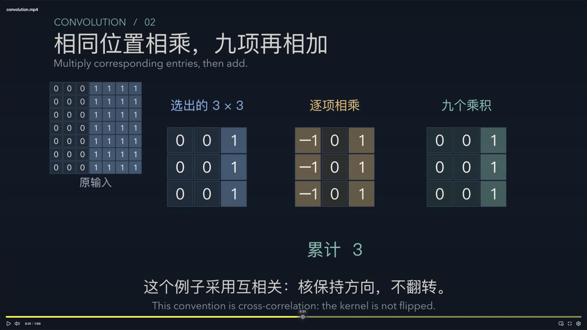

# 全库动画与交互复核

2026-10-10：保留 Bootstrap 原片，原位替换其余 59 部动画。每个主题重新编写对象、动作、讲解与公式出现的顺序。当前共 60 个 MP4，约 41.0 分钟、115.9 MiB；均为 1080p、30 fps、H.264/yuv420p，中英字幕、无音轨。

**质量状态：Bootstrap 是使用者明确认可的版本。本次其余 59 部记为重写后的制作者复核，不记为使用者已认可。** 自动检查说明它们可解码、数值一致、界面可操作；讲解是否足够直观仍需与这些技术结果分开判断。

<!-- bilingual-en:start -->
The Bootstrap film is retained and the other 59 films have been rewritten and replaced in place. Bootstrap is the only film explicitly accepted by the user. The new films have producer review, not user acceptance. Technical validation and teaching quality are recorded separately.
<!-- bilingual-en:end -->

## 现在能追踪的对象

| 主题 | 画面中的连续过程 | 必须保留的边界 |
|---|---|---|
| 卷积 | 输入窗口 → 对应的九次相乘 → 累计和 3 → 放回输出格，再平移窗口 | 单通道、固定核；使用互相关 |
| 反向传播 | 同一前向计算图 → 输出梯度 → 局部导数相乘 → 参数分支 | 梯度对应同一组模型参数 |
| 注意力 | Query/Key → 四个分数 → 共同分母 → 权重乘 Value → 输出；再把未来分数遮为 −∞，重新归一化 | 掩码在 Softmax 前；注意力权重不是因果效应 |
| SVD | 编号圆周点 → 真正旋转 → 沿轴伸缩 → 再旋转 → 舍弃第二方向，椭圆压成线段 | 本例为 2×2 正旋转构造；不声称覆盖反射或所有矩阵 |
| 抽样与置信区间 | 从样本得到统计量，再重复整个过程形成分布或覆盖频率 | 区分样本量、重复次数及固定总体参数 |
| 核方法 | 观测中心 → RBF 相似度 → 带符号系数乘各项 → 全部中心合成预测 | 展示的四项只是部分贡献；完整预测使用 25 个中心 |
| GMM 与 K-means | 先确定当前软分配或硬分配，再移动中心 | 使用对应轮次的分配，避免拿最终分配解释第一次更新 |
| RNN、LSTM、残差网络 | 沿同一状态链追踪传递与梯度因子 | 旁路与门控改变因子，不保证任意网络的梯度稳定 |

其他主题的具体分镜与时间见 `animations/film-manifest.json`；每份实验笔记含当前章节时间和原生视频。交互区“影片参数与延伸对照 → 载入本片的模型与数据”载入相同的完整参数与种子。Bootstrap 使用“影片参数”按钮。

## 迭代中发现并修正的问题

| 阶段 | 实际问题 | 修正与检查 |
|---|---|---|
| 首轮分镜 | 多个主题只有参数变化，中间对象无法追踪 | 59 个主题逐一编写分镜，沿对象身份连接输入、运算和结果 |
| 全库静帧复核 | 空曲线、越界线段、文字遮挡、梯度表述不清 | 增加有效曲线断言、线段裁剪与布局检查；改写池化、RNN 等计算说明 |
| 第二轮与定向复核 | 核中心太近、公式与数值挤在一起、部分标签缺字 | 重选展示中心，分开公式与权重行，替换不支持的字形 |
| 实际 MP4 检查 | Typst 把函数参数归进下标；小数被舍入为 0 | 显式分组下标；小量保留有效数字；检查受影响的实际编码画面 |
| 连续动作复核 | 坐标线性插值不能表现严格旋转 | SVD 改用角度旋转；查看 7.4 秒的中间帧，单位圆与半径保持一致 |
| 最后补修 | 注意力掩码与 SVD 降秩只写在结尾，缺少对应动作 | 加入未来位置归零后重新归一化、椭圆压成线段的实际过程并重渲染 |

已查看全部 59 部的成片检查点；最终修正涉及的画面重新提取并复看。59 部当前影片包含 239 个章节、392 个检查点。这个数量只是复核范围，不作为质量得分。完整检查点时间保存在各 `*-timeline.json`，可重新提取；只保留六份当前联系表，减少磁盘占用。

[卷积](quality/films/convolution.jpg) · [反向传播](quality/films/backprop.jpg) · [注意力](quality/films/attention.jpg) · [置信区间](quality/films/confidence.jpg) · [核方法](quality/films/kernel.jpg) · [SVD](quality/films/svd.jpg)

## 计算、构建与浏览器结果

| 证据 | 本次结果 |
|---|---|
| `tests/films-report.json` | 60 部的编码、完整解码、字节与 SHA-256；59 部与实际章节时间一致；Bootstrap SHA-256 保持不变 |
| `tests/narrative.test.py` | 小的正负数不显示成零、空曲线拒绝、几何坐标单位长度一致 |
| `tests/film_renderer.test.py` | 线段裁剪、近常数范围、文字换行与等比例视窗 |
| 数值与插件回归 | 10 个 JavaScript 测试文件通过，详见 `tests/narrative-regression-report.json`；没有重写既有数值模型 |
| `tests/browser-report.json` | 60 个实验，7401 项，0 失败、0 页面错误 |
| `tests/films-browser-report.json` | 60 个实验，7309 项，0 失败；覆盖每片参数载入、延伸对照、计算项与窄屏 |
| `tests/structure-report.json` | 60 个条目、79 个关联原子、573 条双链及构建一致性检查；唯一失败是全库保护检查发现另一份已修改 Canvas，见下文 |

两套浏览器检查读取同一最终构建 `cb37a70929c17bde5b236ddf3ddcd80c8fce14ef55febf3e575c01d3270573c9`。离线 HTML 的 SHA-256 为 `ca7bfd99977e923a90609a98aae6d07eab2b7a6fe6afb9908073865ee3e2308b`。

结构测试扫描了整个 `00_Knowledge` 的 Git 差异，报告 `利率、即期远期与期限结构.canvas` 属于非 Markdown 改动。该文件不在这次修订范围内，未被覆盖、还原或删除；保留原测试失败记录。其余结构断言无失败。实验笔记由既有生成区更新，生成区外内容受构建器保护；本次没有改写知识原子。

<!-- bilingual-en:start -->
All numerical/plugin suites and both browser suites pass. The vault-wide preservation guard has one failure for an independently modified Canvas outside this task; that file is preserved and the failed report is retained. No knowledge atom was rewritten by this revision.
<!-- bilingual-en:end -->

## Obsidian 实机证据

Mac mini / Obsidian 1.14.4 / Academic：

- Reading 模式加载新版约 61 秒卷积影片，实际播放、暂停、全屏、点击进度条定位至 31 秒，显示九项乘积与累计和 3。
- 同一笔记交互区载入影片参数，点击第九项显示 `1 × 1 = 1 · 前 9 项之和 3`；输出列从 1 改为 0 后，对应窗口、选中输出和累计和共同变为 0，宿主确认参数更新。
- Live Preview 加载同一新版影片，实际从 0 秒播放到结束。当前插件及其他插件的启用状态未改动。

[Obsidian 内的窗口与对应高亮](quality/obsidian-mechanism.png) · [SVD 旋转中的实际编码帧](quality/svd-mid-rotation.png)

本轮没有操作 MacBook、iOS 或 Android，也未复测导出落盘。Mac mini 上的结果不能证明新文件已经到达另一台设备；此前 MacBook 的插件恢复仅为历史记录，见 [[07_Programme/可视化实验室/docs/Obsidian兼容性|兼容性记录]]。

## 保留与清理

每个主题只保留一份当前 MP4，另保留当前源码、时间线、离线包、检查报告和少量检查图。渲染工具环境继续放在 iCloud 库外。没有安装额外插件或依赖；临时渲染、草稿、缓存与旧联系表在收尾时清理。

本轮收尾已清除 396,161,396 字节（约 377.8 MiB）的临时帧、草稿、渲染及 Python 缓存；关闭本轮本地测试服务器和两张浏览器检查页。旧的 15 张成片联系表已替换为 6 张当前联系表。Bootstrap 参考播放器已关闭，原有课程播放器保留。
