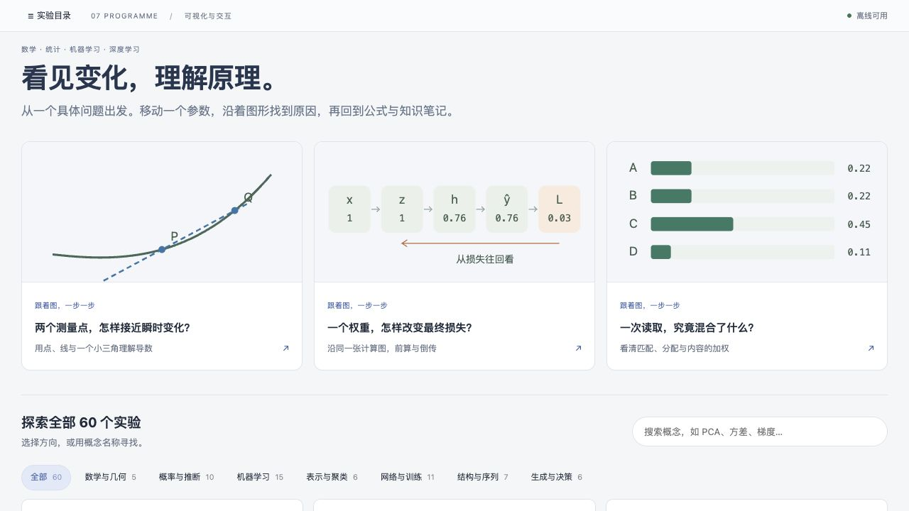
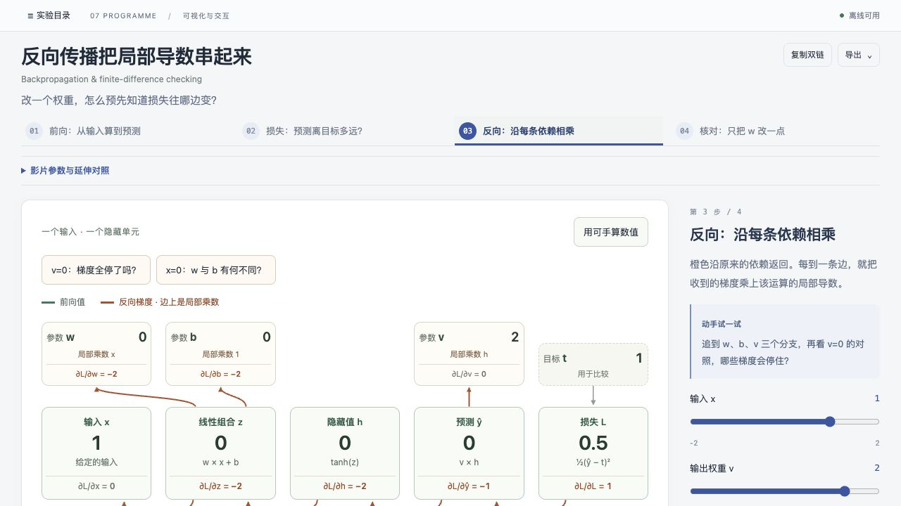
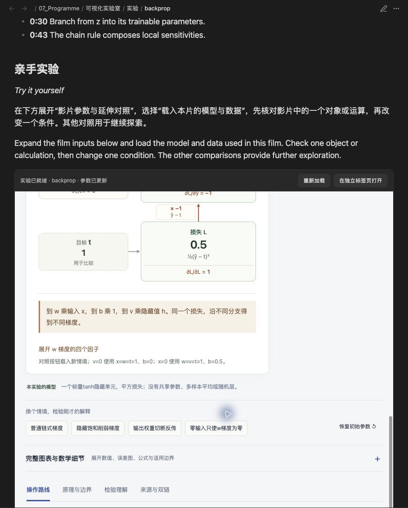
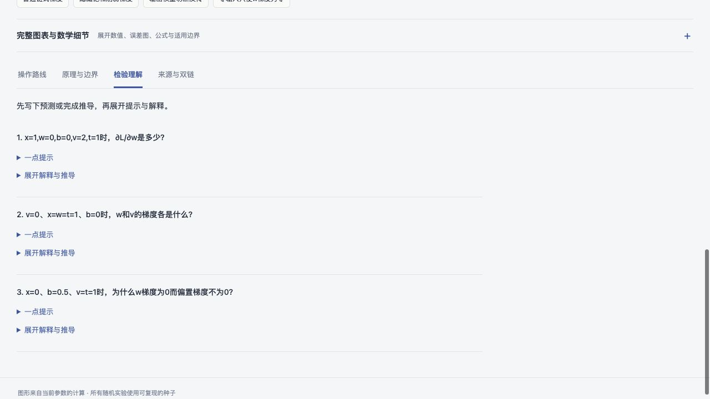

# 可视化实验室：教学体验评估与改造优先级

评估日期：2026-10-15。目标：加快建立概念、追踪运算和迁移应用的速度，并增加理解深度。本次交付是全库评估和改造顺序，实验内容尚未改版。

**结论：保留现有数值内核和有用的几何表达，先完善“预测—执行—追踪原因—验证—迁移”的学习过程；Anatomy 用于其中适合空间化、可拆解的机制。** 建议先解决共用体验问题，再完成 8 个核心主题，之后按先修依赖推进其余主题。每个主题的安排见 [[07_Programme/可视化实验室/docs/实验改造清单-2026-10-15|60 项改造清单]]。

## 评估覆盖与证据边界

- 检查全部 **60 项**的教学问题、参数、步骤、情境、理解检验及影片章节。页面结构共用同一套应用代码。
- 对当前 **60 部 MP4** 各抽取 36% 和 72% 时点，共 **120 帧**；另外细查双降、校准各 4 帧，以排除过渡帧造成的误判。视频总长约 **41 分钟**，单部约 **28–81 秒**，中位数约 **39 秒**，均没有音轨。
- 在当前离线包中实际进入并操作 **13 项**：backprop、attention、convolution、normalization、bootstrap、optimizers、pca、rnn、causal、softmax、rl-bellman、diffusion、confidence。操作包括切换教学步骤、改参数、选局部乘积、重抽样、数值微扰及展开理解检验，深度不同。
- 在 **Obsidian 1.14.4** 的当前笔记栏中实际定位反传影片、进入内嵌交互并切换反传步骤；浏览器截图视口为 1280×720。原生截图只保留实验所在面板，裁去无关侧栏。
- 当前 HTML 与构建清单 SHA-256 一致，清单中的源码均匹配；因此本轮的代码观察对应实际运行版本。具体记录见 [核查范围](评估证据-2026-10-15/核查范围.json)、[影片时点与哈希](评估证据-2026-10-15/影片抽帧清单.json)。

**本轮没有完整播放全部影片、逐项穷尽所有参数、重做全部数学证明、测试其他设备，或测量真实学习增益。** 下文的教学效果判断是基于当前界面与任务结构的设计评估；优先级是改造建议，不是学习效果排名。既有验收记录只用于了解建设历史，截图证据全部来自本轮。

## 沿学习路径看，问题发生在哪里

1. **找到主题：入口清楚，先修路径不足。** 60 项可搜索、按方向筛选，也有三个精选入口；但“我现在要理解反向传播，应先会哪些操作”主要仍要自己判断。许多开场问题直接进入反例与边界，更适合作复习。建议在核心路线中明确“学完能完成什么”，并给出最少的先修入口。
2. **看懂演示：已有具体过程，节奏控制较粗。** 卷积影片逐项乘加、Bootstrap 区分观测和重抽样均值，都有可保留的对象连续性。当前影片依赖中英文字、公式和运动同时解释，没有音轨；密集计算只能手动暂停、拖动时间条。建议把章节变成可控的计算步骤，必要时提供可关闭的中文讲解音轨。音轨的价值仍需试用验证。
3. **接着动手：模型相通，观看状态没有接续。** 视频在笔记上方，交互在下方；“影片参数与延伸对照”默认折叠，需手动载入。反传影片使用 w=0.5，交互首步使用 w=0；这两个例子都合理，却需要读者重新建立对应。建议提供“从这一运算继续操作”，同步对象、参数和当前步骤。
4. **解释变化：局部机制差异很大。** 5 项有专用故事渲染；另 7 项接入专用机制视图；其余 48 项主要用通用图表呈现当前结果，虽有逐项编写的导读，过程可见性仍取决于图表本身。RNN 的时间贡献柱图、优化器的轨迹图都能比较结果，但主场景没有让人操作产生这些结果的局部状态。
5. **验证理解：题目有价值，反馈尚未接入实验。** 全库已有提示和解释，但共用“检验理解”主要是展开答案。不能据此判断预测错在什么环节，也没有把新题的条件自动带回对应机制。反传已有 w±0.1 的局部预测/实际变化比较，这是值得推广的基础。

## 最值得保留的部分

- 数学模型、参数与随机种子可追溯；已有中间数据、来源支持范围和适用边界。这比只有视觉特效的演示更适合继续深化。
- 反传的参数分支与零梯度反例、注意力的 Q/K/V 区分、卷积的单项核对、Bootstrap 的观测编号，已有具体教学价值。
- 原理、边界与来源可展开；小模型明确写出限制。例如 attention 是四个手工二维向量，diffusion 是一维 Gaussian 条件推断。这些限制应成为通往一般模型的起点。
- 二维图在 PCA、投影、抽样分布、校准等主题上已有合适的语义。改造应增强选择、对照和推导联系。

## 需要优先修复的共用问题（P0）

| 问题与本轮证据 | 对理解的影响 | 具体改造及验收 |
|---|---|---|
| 视频与实验分开，且反传默认例子不同；笔记还保留“第一图、第二图”的观察说明 | 看完影片后要重新找对象、参数和步骤 | 统一叙事步骤与当前参数；视频定位点可进入相同交互状态；同步更新笔记中的观察路线 |
| 44 项在首步之后至少有一步会载入预设参数。Softmax 实测：将 z₁ 改为 4，再切到第 3 步，变为 z₁=3、z₃=−1、T=0.5、目标 C | 换讲解视角与换实验条件混在一起，难以归因 | 普通步骤保留当前数据；换例作为显式动作，展示变更列表并可撤回；导读中的预期结论随当前条件变化 |
| 反传第 3 步同时显示整张图的多组导数；在窄 Obsidian 栏中改成纵向长图，操作和结果会分离 | 需在多处寻找本次乘法，滚动又丢失前后关系 | 本步只突出一个局部运算，前向缓存可回看；保持当前节点、输入梯度和控制区同屏；在实际笔记栏验收 |
| 理解检验只展开提示/答案，未读取学习者的判断 | 容易把“认得解释”当作“能够独立推导” | 增加可跳过的预测、局部计算和迁移任务；提交后指出具体差异，并可回到对应步骤；私人学习记录另存 |
| 通用滑块在当前 DOM/辅助功能树中缺少可访问名称，选择框有名称；查验 Value 尺度时按标签定位失败 | 读屏或语音操作难以识别参数；普通用户也只能靠位置寻找 | 给 input 显式关联 label，保留键盘操作和焦点；用当前渲染树复核名称、值、单位与状态变化 |

预设不是问题本身。当前实现对“自定义条件”已有提示与重新载入按钮；缺少的是切换步骤时的变更说明和连续比较。无障碍判断只覆盖本轮确认的命名问题及布局风险，未做完整 WCAG 审计。

## Anatomy 怎样用才有价值

官方 Anatomy 的核心是把技术机制做成可操作的等距视角对象，并让运动和读数来自同一个模型；还要求大量真实部件和精细的空间关系。它提供的是一种视觉制作方法，教学结构和概念核验仍需单独设计。[官方仓库](https://github.com/wheresryan22/anatomy)

本实验室建议采用三种表达：

| 表达方式 | 适用主题 | 具体用途与边界 |
|---|---|---|
| 可拆解的运算装置，结合二维计算图 | 前向/反向传播、卷积、残差、RNN/LSTM、GNN、Bellman | 点开一个算子，追踪它消费的数、缓存的数和输出；每条移动路径必须对应真实依赖。反向传播显示敏感度及分支求和，不能让人误以为是把前向数值倒放 |
| 结构图与矩阵/向量同步 | 神经元、Attention、Softmax、归一化、Dropout | 从一个单元、一行或一个窗口开始，选择局部对象时同步高亮公式项和矩阵位置；保持张量轴与维度可见 |
| 以二维几何和统计图为主 | 导数、线性变换、PCA/SVD、抽样与推断、校准、泛化、密度变换 | 用拖动、叠影、固定坐标、分布与样本身份讲清变化；仅在真实空间关系需要时引入立体图 |

**装饰部件数量不作为教学验收指标。** Anatomy 的细节要求可能增加制作成本和视觉搜索负担。先在一个运算装置中验证“移动的部件究竟解释了哪个数学关系”，再决定是否扩展。全库统一使用机械隐喻的收益没有证据支持。

反传应建立“局部导数乘上游梯度，分支贡献在汇合处相加”的明确含义；这是选取交互对象的数学依据。[Stanford CS231n：Backpropagation](https://cs231n.github.io/optimization-2/)

## 改造顺序

优先级综合考虑：与当前机器学习目标的关系、被其他主题依赖的程度、关键运算目前是否可见、误解的后果、现有模型能否直接复用。没有用未经验证的分数制造精确排名。

### P0：先完成共用学习过程

先以反传实现参数连续性、局部步骤、预测与核对、窄栏布局、视频接续，然后在卷积和 Bootstrap 上验证这些共用能力。通过之后再推广到其他主题。保持共享数值计算和现有知识笔记链接。

### P1：第一批 8 项，形成两条完整主线

| 顺序 | 主题 | 应增加的学习能力 |
|---|---|---|
| 1 | backprop | 缓存前向值 → 逐边倒传 → 参数梯度 → 一次更新后重新前算；再扩展到分支汇合与矩阵形状 |
| 2 | neuron、activations | 输入项怎样进入加权和；局部输入扰动怎样变成输出扰动；从这一层读懂反传乘数 |
| 3 | gradient | 把求得的梯度转换成一步参数更新，保留旧位置和实际损失，分清求导与优化 |
| 4 | softmax → attention | 从共享分母到一次完整 QKᵀ → mask → softmax → V 读取，再映射到矩阵 |
| 5 | convolution、normalization | 保留现有局部运算，增加固定对象上的逐项追踪、预测反馈与张量轴联系 |

这批共 8 项。backprop 是第一试点；其余按依赖顺序接入，不一次并行重画。第一批应覆盖“计算链”“矩阵运算”两种表达；Bootstrap 用作第三种统计表达的对照验收样例。

### P2：第二批 30 项，补齐推理与迁移

分组推进：表达与训练（MLP、优化器、初始化、正则化、残差等）；时间与状态（RNN、LSTM、GNN、Bellman）；几何（导数、投影、PCA/SVD、Jacobian）；统计证据链（抽样、Bootstrap、置信区间、检验、Bayes、偏差方差、模型选择等）。

优化器本轮实测“前进一步”把更新次数从 **60 加到 70**，图上增加轨迹却看不到单次的梯度、动量或二阶矩。这类页面需要可检查的一次更新状态。RNN 要能从某根贡献柱回到对应的时间路径。统计页面应让一次样本、一个统计量和一个分布位置之间有持续对应。

### P3：其余 22 项，按前置路线成熟度再深化

生成模型、策略梯度、对比学习、复杂容量现象及其他专门主题逐项推进。保留当前内容用于查阅，先补通往一般模型的桥梁。例如 Gaussian 去噪例之后需明确哪些对象会由神经网络估计；不应把一条分布曲线当作完整扩散模型的演示。

各批次的数量、逐项理由、建议表达和验收任务详见 [[07_Programme/可视化实验室/docs/实验改造清单-2026-10-15|完整改造清单]]。P2/P3 表示施工顺序，并不意味着这些知识不重要。

## 新版本怎样证明“更快、更深”

先建立同一批等价任务，再比较旧版和新版。以下是拟采用的验收标准，尚未做用户实验：

- **更快**：记录完成首次正确预测与解释所需的时间、求助次数，以及来回寻找图例/参数的次数。仅在答案质量至少保持时解释时间减少。
- **更深**：换参数、换符号或增加一条分支后，仍能给出预测、定位原因并解释适用边界；第二天用新例复测。小例最终要连接到张量形状、批量计算或真实代码中的对应操作。
- **反传样例**：区分前向值、局部导数和损失梯度；解释 v=0 时不同参数梯度的区别；完成一次更新后的重算；解释同一参数多次使用为何累加；对照向量版的维度。
- **注意力样例**：独立改变 K、V 和 mask，预测哪些量会变；核对加权和与输出形状；能说明当前单头手工向量例未包含哪些训练步骤。
- **统计对照样例**：区分 n 与 B；追踪一个重抽样均值如何进入分布；说明原样本缺失信息为何不能靠增加 B 补回。

先用等难度但不同数值的题目，交替安排版本，减少记住旧题答案的影响。一次个人试用只能支持本人的体验结论，不能推成普遍教学效果。实际作答和掌握情况保存在忽略的私人记录中。

数值正确、影片/交互一致、真实 Obsidian 可用和学习者迁移表现分别验收。功能测试通过只覆盖前几项中的一部分。

## 本轮证据入口

- [Obsidian 影片定位](评估证据-2026-10-15/04-Obsidian影片.png) · [笔记内交互入口](评估证据-2026-10-15/05-Obsidian嵌入.png)
- [注意力贡献](评估证据-2026-10-15/07-注意力读取.jpg) · [卷积单项与累计和](评估证据-2026-10-15/09-卷积单项核对.jpg) · [归一化分组](评估证据-2026-10-15/10-归一化分组.jpg)
- [Bootstrap 观测身份](评估证据-2026-10-15/11-Bootstrap重抽样.jpg) · [优化器的步数控制](评估证据-2026-10-15/12-优化器轨迹.jpg) · [RNN 梯度贡献](评估证据-2026-10-15/14-RNN共享梯度.jpg)
- [Softmax 切换前](评估证据-2026-10-15/softmax-手动输入.txt) · [切换后](评估证据-2026-10-15/softmax-切换步骤.txt)
- [全部影片抽帧索引](评估证据-2026-10-15/README.md)

当前实验源码、离线包和影片保持原版本；本轮仅新增评估文档、证据与入口链接。

