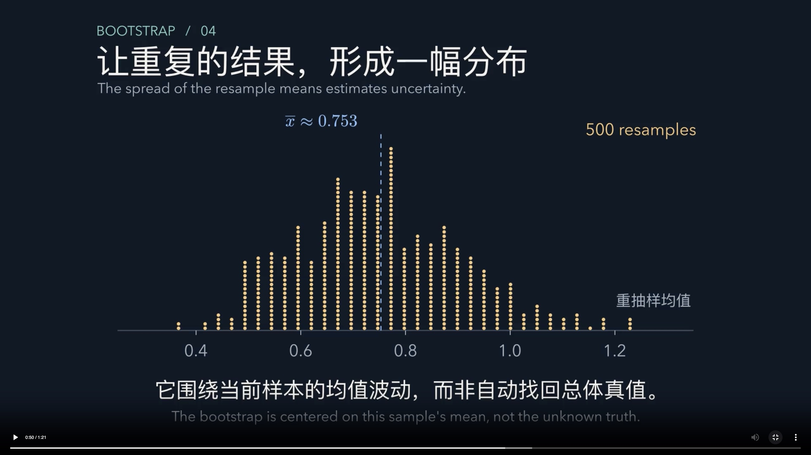
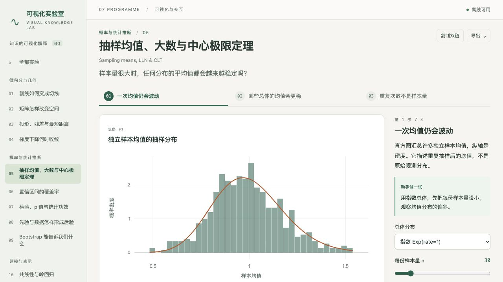
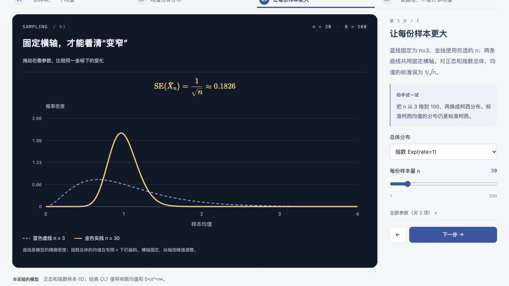
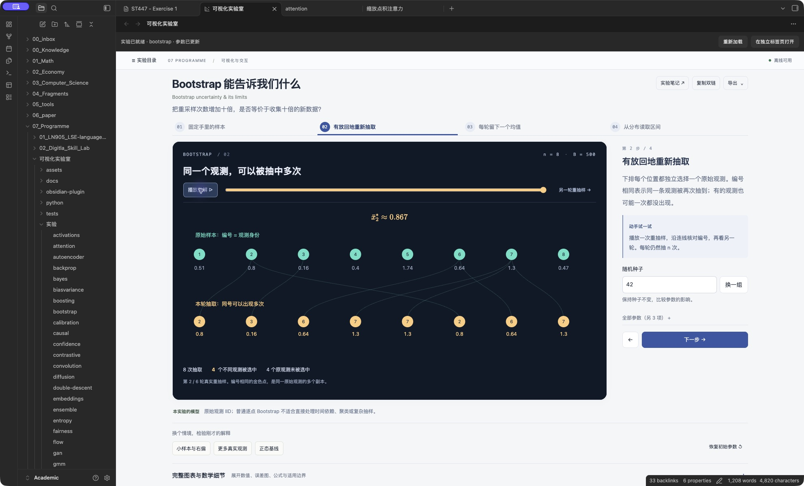
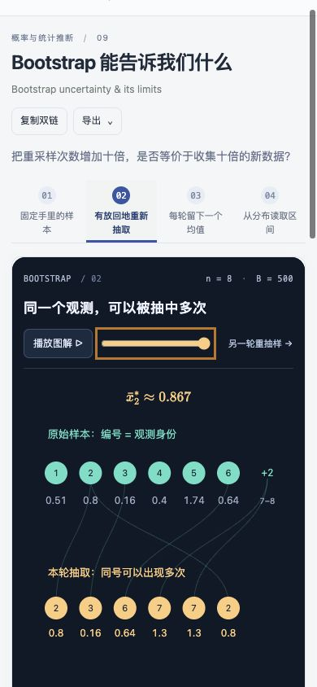

# 抽样与 Bootstrap：分镜重做与实测

本页为早期抽样与 Bootstrap 的修订记录；其余主题的当前成片与复核范围见 [[07_Programme/可视化实验室/docs/全库动画验收|全库动画复核]]。

`sampling` 和 `bootstrap` 各有四个可交互步骤；Bootstrap 另有实际用 Manim 渲染的 81 秒原生视频。全库 60 项共用布局、目录开关和整数控件。其余 59 项尚无 Manim 成片；其余 58 项的逐图视觉重做仍待完成。本文记录实现与核验范围，不把技术通过当作视觉质量已获认可。

## Math-To-Manim 的参考范围

查看了 [Math-To-Manim 上游项目](https://github.com/HarleyCoops/Math-To-Manim) 和它的 [视觉审查说明](https://github.com/HarleyCoops/Math-To-Manim/blob/main/docs/JEV_DESIGN_MAP.md)。本轮采用逐步展示数学对象、固定颜色含义、把公式放在对应画面、检查实际渲染结果的做法。

交互部分使用本地 SVG，复用现有数值内核；随后安装 Manim 0.21.0，手工编写 `animations/bootstrap.py` 并实际渲染视频。未安装或调用 Math-To-Manim 的自动生成链和模型服务。离线 HTML 由原有插件读取，视频由 Obsidian 原生播放器读取。

## Manim 成片的审查与接入

成片：`media/bootstrap.mp4`，1920×1080、30 fps、H.264/yuv420p，81.160 秒，6,349,180 字节，无音轨。SHA-256：`7b4277551b9a5d0256f49c35e28d625eb081d99780db0312127c2e41c41675c2`。

| 实际渲染轮次 | 发现与处理 |
|---|---|
| 480p 草片 | 核对完整样本→有放回复制→均值→500 个结果；发现均值上横线被错误排为竖线，横轴标题与刻度重叠，区间公式遮图 |
| 720p 修订 | 使用数学 overline，移动轴标题，分布退场后再出现公式；逐帧复核后发现两条分位数竖线仍穿过公式 |
| 1080p 修订 | 公式出现时把竖线缩成端点短线；合成例子与三位小数说明移到开头；分位数阶段增加对应讲解 |
| 1080p 定稿 | 第一帧直接显示完整问题与样本，解决原生播放器未播放时的黑色空白封面；重新检查首帧、区间帧和原生播放 |

六份重抽均值由 NumPy 对真实索引独立复算；分位数与条件标准差单独核对，500 个分箱计数总和保持 500。显示的 B、C、F、G 出现次数分别为 2、1、2、3。成片均值与本机交互步骤均为约 0.867。

原生检查发生在 **Mac mini / Obsidian 1.14.4**：阅读模式与 Live Preview 均能播放、暂停；观察到进度分别达到 0:13、0:16；点击时间轴定位到 0:50.898；坐标点击全屏按钮后实际看到完整全屏画面，退出回到笔记。自动化拖动手势未可靠移动进度，验收范围记为点击定位和键盘/辅助功能增减。下方交互实验仍可切换重抽步骤与播放图解。**新成片尚未在 MacBook 上复验。**

最终结构检查通过：11,768 项检查、505 条双链；全片 H.264 解码检查无错误。

笔记仍使用原有双链，只增加原生视频嵌入与简短说明；此前正文逐字节保留。生成器复跑仅改变 Bootstrap 笔记，其他 59 个实验入口及总入口内容不变。没有修改 `.obsidian/` 或增加播放器插件。

实际分镜参考时间：原始样本 0:00；重复抽取 0:18；计算均值 0:21；一个均值成为一个点 0:28；500 个结果的分布 0:51；区间公式 1:01；区分 B 与 n 1:13。时间是帧时间取整，完整值由渲染脚本输出。

环境约 346 MB，保留一个可复用 Manim 工具环境；定稿后删除本次临时渲染目录中的旧清晰度视频、片段、排版缓存和临时帧。库内仅保留当前 MP4、源码及当前验收图片。

原生媒体格式依据：[Obsidian 支持格式](https://obsidian.md/help/file-formats)；公式排版依据：[Manim MathTypst](https://docs.manim.community/en/stable/reference/manim.mobject.text.typst_mobject.MathTypst.html) 与 [Typst overline](https://typst.app/docs/reference/math/underover/)。数值机制与适用边界复核：[Berkeley Stat 20 Bootstrapping](https://stat20.berkeley.edu/fall-2025/3-generalization/09-bootstrapping/notes.html)。

## SVG 交互部分的实际审查过程

| 轮次 | 观察到的问题 | 修改及复核 |
|---|---|---|
| 1 | 旧版直接显示均值直方图，缺少“一个均值来自一整份样本”的可见过程；目录长期占据绘图宽度 | 增加观测汇合成均值、实际重抽样身份追踪；目录默认收起，保留原生按钮打开 |
| 2 | 播放按钮在图下方，首屏难找到；图形宽度变化会放大整张 SVG 的高度 | 播放和进度移到图上方；按实际容器宽度生成 SVG；压缩外层标题区 |
| 2 | 四舍五入的数字写成等号容易暗示精确相等 | 数值近似改用 `≈`；图中编号和值仍来自实际抽取记录 |
| 3 | n=8、seed=42 的第一轮 Bootstrap 恰好是八项各出现一次，无法直接展示重复 | 首次展示六轮真实记录中含重复的一轮，标明实际轮次；循环时遇到无重复的轮次也如实说明 |
| 3 | 原 Bootstrap 范围控件 step=5 会把合法的 n=8 显示为 10，而计算仍用 8 | 在共用控件生成函数中，让整数模型使用 step=1；新增逐步骤控件值与计算参数一致性检查，全库通过 |
| 4 | 固定坐标比较最初复用了模拟极值之间的曲线，理论尾部在窗口中途结束 | 在同一个数值模型中生成覆盖完整固定窗口的密度曲线，核对三个分布的解析值及种子不变性 |
| 3 | 窄屏同时显示很多编号会拥挤 | 390 像素下展示前六项，明确标出省略编号范围；均值和不同观测计数仍使用全部 n 项 |

旧版实际截图：

## 检查过的使用步骤

1. **一份样本变成一个均值：通过。** 可播放、暂停、拖动进度、切换六份真实示例；点的竖向错开仅用于辨认，横坐标才表示数值。
2. **比较抽样分布：通过。** n=3 的参照曲线和当前 n 共用固定横轴；正态、指数、柯西分别使用已有模型的精确密度。超出直方图窗口的数量有明确说明。
3. **Bootstrap 有放回抽取：通过。** 原始身份、连线、抽取值、重复计数和均值可对应；B 增加不会更换原始样本。
4. **窄窗口：通过所测范围。** 全库检查实际宽度 320、390、768、1200 像素；人工查看了 Bootstrap 的 390 像素画面。
5. **原生 Obsidian：本机通过。** Mac mini 的 Obsidian 1.14.4 实际重新加载离线包，打开独立页、播放 Bootstrap 动画，打开实验笔记的 Live Preview，再切到 Reading 模式并播放。新视觉版本尚未在 MacBook 上复验。

固定坐标比较的最终画面：

本机 Obsidian 动画终点：

窄窗口实际画面：

## 数值与交互证据

- `tests/core.test.js`：73,708 项检查通过，覆盖基础十二项模型；新增六份样本/重抽样身份记录与实际均值的一致性、增加 B 后保留原始记录的检查。
- `tests/browser-report.json`：60 项实验，7,429 项交互检查，零失败、零页面错误。包括全部步骤、参数边界、预设、公式、真实测试宽度，以及新动画的进度、暂停和导航清理。
- `tests/structure.test.js`：60 项目录、79 个映射原子、502 条双链的结构检查通过。
- `tests/obsidian-plugin.test.js`：隔离 iframe、CSP、来源白名单、目录延迟到达和笔记导航检查通过。
- 最终浏览器检查的 build id：`b7a85b3fc2a4fa1fe6ce3d4a11f24c10009da446ebbdf18c6010eed0bf529f09`。

这里没有进行屏幕阅读器的完整验收，也没有把浏览器窄宽测试当作 Obsidian 移动端验收。视觉质量仍需逐项人工审阅。

## 打开更新

在 iCloud 同步完成后，打开 Bootstrap 笔记即可看到原生视频。下方原有实验点击 **重新加载** 可读取最新离线包。此次无需更新插件安装文件。磁盘同步与另一台机器的实际显示分别验证。
